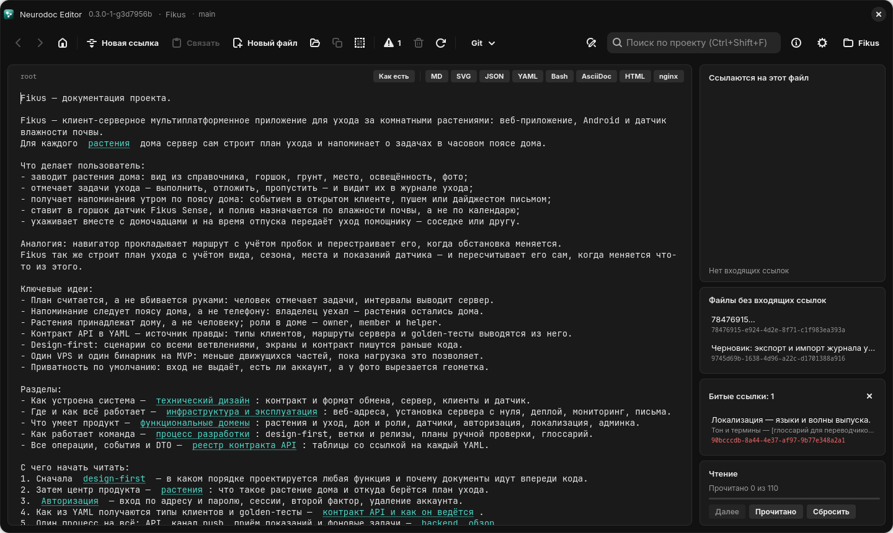

<div align="center">


# Neurodoc

**Документация как граф знаний: маленькие текстовые файлы, связанные ссылками прямо в
тексте, — и редактор, в котором по ним ходят, как по сайту.**

[](LICENSE)
[](https://vabuter.github.io/neurodoc/)


[Сайт-книга](https://vabuter.github.io/neurodoc/) ·
[Формат](#формат-neurodoc) ·
[Возможности](#возможности) ·
[Установка](#установка) ·
[Пример](example/root) ·
[Разработка](#разработка)

</div>



> **In English.** Neurodoc is a plain-text documentation format: a folder of small UTF-8
> files that link to each other with `[anchor](uuid)` references written right inside the
> sentences, forming a knowledge graph rooted at a file named `root`. Neurodoc Editor is a
> browser-like editor for such catalogs with the same features on Windows 11 (WinUI 3),
> Linux (GTK 4) and Android (Jetpack Compose): click-through navigation with autosave,
> compact links, viewers for SVG, Markdown, YAML and more, graph panels (backlinks, orphans,
> broken links, shortest paths from `root`), reading progress and a built-in git workflow.
> The user interface and the documentation are in Russian — see the
> [site-book](https://vabuter.github.io/neurodoc/).

## Что это

**neurodoc** — формат каталога документации. Каталог — обычная папка: файл `root`, с
которого начинают читать, и папка `_content/` с файлами-«карточками», чьи имена —
UUID. Каждый файл — один блок знаний, а ссылки на другие файлы вписаны прямо в
предложения: `[подход к разработке](5c673c53-8ad9-49eb-9fb6-ffb3954848f0)`. Рядом могут
лежать папки с файлами в собственных форматах — YAML-контракты, SVG, конфиги, — на них
ссылаются по относительному пути. Формат читается без специальных инструментов: это
текст, одна регулярка для ссылок и hash-таблица «имя файла → текст». Описание формата
лежит в корне каждого каталога, так что по нему может работать и программа, например
ИИ-агент.

**Neurodoc Editor** — редактор таких каталогов в трёх версиях с одинаковой
функциональностью: для Windows 11, Linux и Android. Он устроен как браузер с правкой на
месте: клик по ссылке открывает файл, «назад» и «вперёд» возвращают туда, где вы были, а
всё, что вы пишете, сохраняется само.

## Возможности

- **Навигация как в браузере** — переход по ссылке кликом, история «назад / вперёд» с
  возвратом каретки и прокрутки, открытие файла по id.
- **Компактные ссылки** — в тексте видно только подчёркнутый якорь; режим «Как есть»
  показывает файл ровно таким, каким он лежит на диске.
- **Просмотр форматов** — SVG (с масштабом и сменой фона), JSON, YAML, Bash, Markdown,
  AsciiDoc, HTML и конфиги nginx; ссылки в отрисованных Markdown и AsciiDoc кликабельны.
  Библиотеки встроены — всё работает офлайн.
- **Граф знаний на виду** — кратчайшие пути от `root` до текущего файла, обратные ссылки,
  файлы-сироты и битые ссылки.
- **Порядок чтения** — обход каталога от `root`, отметки «Прочитано» и кнопка «Далее».
- **Поиск** — по файлу, по всему проекту, поиск с заменой.
- **Автосохранение и слежение за диском** — правки из других программ (например, `git pull`
  в терминале) подхватываются сразу, а своё сохранение не вызывает перечитывания.
- **git внутри** — публикация каталога на сервере, клонирование, ветки,
  «Сохранить / Получить / Синхронизировать», история коммитов и дельты файлов, понятный
  выбор при конфликте.
- **Миграция** со старой формы ссылок `<uuid>` с резервной копией каталога.

## Формат neurodoc

```text
каталог/
├── root                 ← главная страница: отсюда начинают читать
├── README.md            ← описание формата для людей и программ
├── _content/            ← файлы-карточки, имена — UUID в нижнем регистре
│   ├── 1b9d6bcd-bbfd-4b2d-9b5d-ab8dfbbd4bed
│   └── …
└── contract/            ← файлы в собственных форматах, имена доменные
    └── auth/start.yaml
```

- Все файлы — текст в UTF-8 без BOM. Заголовок файла — его первая непустая строка.
- Ссылка — `[текст](uuid)`: текст (якорь) встроен в предложение, однострочный и не
  содержит `]`. Пустой якорь `[](uuid)` означает «показать заголовок целевого файла».
- Вместо UUID в ссылке может стоять путь к файлу в собственном формате — **относительно
  файла, где написана ссылка**: из `_content/` это `[auth.start](../contract/auth/start.yaml)`.
- Ссылки ведут только внутрь каталога. Источники ссылок — только `root` и файлы `_content/`:
  в YAML или SVG запись вида `[текст](что-то)` ссылкой не считается.
- Голый UUID ссылкой не считается, как и `<uuid>` — это прежняя форма, редактор предлагает
  перевести её в новую.

Файлы образуют граф знаний с корнем в `root`. Полное описание с примерами и алгоритмом
разбора для программ — в главе [«Формат neurodoc»](https://vabuter.github.io/neurodoc/format/index.html)
сайта-книги.

## Пример

В [`example/`](example/root) лежит эталонный каталог — документация выдуманного сервиса
ухода за комнатными растениями **Fikus**: технический дизайн, домены, сценарии BPMN в SVG,
контракт API в YAML, пошаговая настройка сервера, конфиги со ссылками в комментариях.
Откройте копию папки `example` в редакторе как проект (правки сохраняются сразу, поэтому
не сам `example/`) — на ней видно всё, что умеют формат и приложение. Подробный разбор —
в главе книги [«Каталог Fikus»](https://vabuter.github.io/neurodoc/example.html). Проект
выдуманный: домены `*.fikus.example` и адреса из документационных диапазонов.

## Установка

Готовых сборок пока нет — редактор собирается из исходников скриптами из корня
репозитория. Подробно, с зависимостями для каждой платформы, — в главе
[«Установка»](https://vabuter.github.io/neurodoc/editor/install.html).

**Linux** (GTK 4.14+ и libadwaita 1.5+: Fedora 40+, Ubuntu 24.04+, Debian 13+; Rust 1.92+).
Пакеты для Fedora:

```bash
sudo dnf install rust cargo gtk4-devel libadwaita-devel webkitgtk6.0-devel
```

Сборка и установка для текущего пользователя — ярлык появится в меню приложений:

```bash
./linux-deploy.sh
```

**Windows 11** — нужен .NET 10 SDK. Release-сборка с самодостаточной публикацией в папку
(путь задаётся в начале скрипта):

```bat
build-deploy.bat
```

**Android** — нужен Android SDK. Сборка APK и установка на телефон, подключённый по USB:

```bash
./android-install.sh
```

На Windows — `android-install.bat`.

## Документация

| Где | Что |
| --- | --- |
| [Сайт-книга](https://vabuter.github.io/neurodoc/) | формат, работа в редакторе, git, сборка и устройство — исходники в [`book/`](book/src/SUMMARY.md) |
| [`doc/`](doc/root) | документация проекта в самом формате neurodoc — откройте папку в редакторе как проект |
| [`windows/`](windows/README.md), [`linux/`](linux/README.md), [`android/`](android/README.md) | README каждой версии: технологии, сборка, где лежат настройки |
| [`CLAUDE.md`](CLAUDE.md) | полный свод решений и подводных камней — написан для ИИ-агента, но полезен и людям |

## Структура репозитория

| Папка | Что это |
| --- | --- |
| [`windows/`](windows/) | десктопное приложение для Windows 11: C# / .NET 10, WinUI 3 (Windows App SDK), unpackaged + self-contained |
| [`linux/`](linux/) | десктопное приложение для Linux: Rust, GTK4 / libadwaita, WebKitGTK |
| [`android/`](android/) | мобильное приложение: Kotlin + Jetpack Compose |
| [`doc/`](doc/) | документация проекта в формате neurodoc |
| [`example/`](example/) | эталонный каталог neurodoc (выдуманный проект Fikus) — на нём проверяют изменения |
| [`book/`](book/) | сайт-книга на mdBook, публикуется на GitHub Pages |

## Разработка

- **Одна функциональность — три версии.** Правка формата или поведения доводится до
  Windows, Linux и Android, а описание — до `doc/` и `book/`.
- **Проверки.** У Linux-версии есть тесты домена и git на копии `example/`
  (`cd linux && cargo test`) и самопроверка интерфейса со снимками окна
  (`NEURODOC_SMOKE`); Windows- и Android-версии проверяются запуском. Подробности — в главе
  [«Проверки»](https://vabuter.github.io/neurodoc/dev/testing.html).
- **Версия** живёт только в git-теге `vX.Y.Z` на `main`: все три сборки читают её через
  `git describe`. Выпуск — `./release.sh 0.3.0` (на Windows — `release.bat`); скрипт ставит
  тег и ничего не отправляет.
- **Язык проекта — русский**: интерфейс, комментарии в коде, документация и сообщения
  коммитов.

Вопросы и предложения — в [issues](https://github.com/vabuter/neurodoc/issues), правки — через
pull request. Как устроен код и с чего начать, рассказывает глава
[«Для разработчиков»](https://vabuter.github.io/neurodoc/dev/index.html).

## Лицензия

[MIT](LICENSE). В приложения встроены сторонние компоненты со своими лицензиями:

| Компонент | Лицензия |
| --- | --- |
| [highlight.js](https://highlightjs.org/) 11.9.0 | BSD-3-Clause |
| [marked](https://marked.js.org/) 12.0.2 | MIT |
| [Asciidoctor.js](https://asciidoctor.org/) 2.2.8 | MIT |
| шрифты [Inter](https://rsms.me/inter/) и [JetBrains Mono](https://www.jetbrains.com/lp/mono/) | SIL Open Font License 1.1 |

Тексты лицензий лежат рядом с файлами компонентов в
[`windows/NeurodocEditor/Assets`](windows/NeurodocEditor/Assets).
