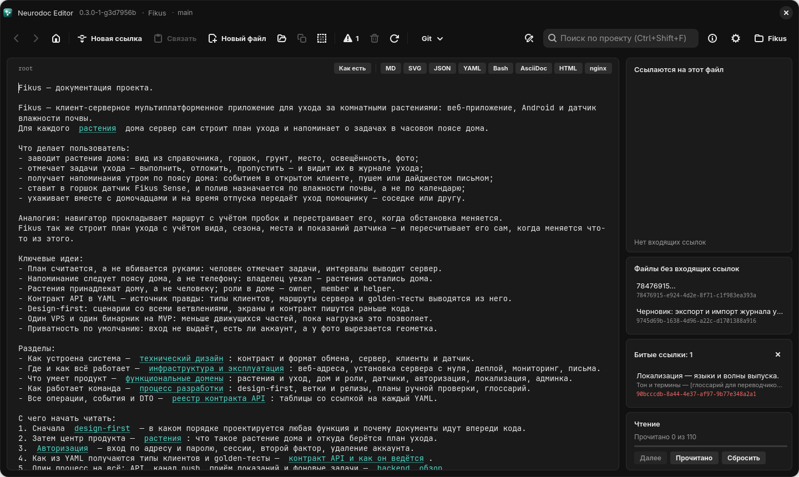

# Neurodoc

Neurodoc — это формат документации и редактор к нему. Документация хранится как папка
маленьких текстовых файлов, которые ссылаются друг на друга прямо из предложений, а
Neurodoc Editor позволяет ходить по ним, как по сайту, и тут же править — с
автосохранением.



*Neurodoc Editor на Linux: открыт файл `root` каталога-примера Fikus, справа — карточки связей и прогресса чтения*

## Формат neurodoc

Каталог neurodoc — обычная папка, а его файлы складываются в граф знаний:

- чтение начинается с файла `root` в корне каталога;
- остальные заметки лежат в папке `_content`, их имена — UUID в нижнем регистре;
- ссылка `[якорь](цель)` встроена прямо в предложение, а с пустым якорем `[](цель)`
  вместо текста показывают заголовок целевого файла — его первую непустую строку;
- рядом могут лежать папки с файлами в собственных форматах — YAML-контракты, SVG-схемы,
  конфиги; на них ссылаются по пути относительно того файла, где написана ссылка;
- из ссылок видно, кто ссылается на файл, какие файлы потерялись и какие ссылки ведут
  в никуда.

Условный фрагмент файла `root`:

```text
Fikus — сервис ухода за комнатными растениями.

Прежде чем писать код, прочитайте про [подход к разработке](5c673c53-8ad9-49eb-9fb6-ffb3954848f0),
а вход в приложение описан контрактом [auth.start](contract/auth/start.yaml).
```

Первая ссылка ведёт на файл `_content/5c673c53-8ad9-49eb-9fb6-ffb3954848f0`, вторая — на
YAML-файл `contract/auth/start.yaml`. В редакторе от обеих видно только подчёркнутый текст.
Полная спецификация — в разделе [Формат neurodoc](format/index.md).

## Neurodoc Editor

Редактор существует в трёх версиях с одинаковой функциональностью:

| Версия | На чём написана |
| --- | --- |
| Windows 11 | C# / .NET 10, WinUI 3 (Windows App SDK) |
| Linux | Rust, GTK4 / libadwaita, WebKitGTK |
| Android | Kotlin, Jetpack Compose |

Работа с каталогом устроена как в браузере:

- проект открывается на файле `root`; щелчок по ссылке — переход, «Назад» и «Вперёд» ходят
  по истории переходов ([Навигация](editor/navigation.md));
- правка — с автосохранением; ссылки свёрнуты до подчёркнутого якоря, а режим «Как есть»
  показывает файл ровно как на диске ([Редактирование и ссылки](editor/editing.md));
- «Новая ссылка» превращает выделенный текст в ссылку на новый файл и сразу переводит в
  него, «Связать» делает выделенный текст ссылкой на файл, скопированный кнопкой
  «Копировать ссылку»;
- файлы в собственных форматах со знакомым расширением открываются сразу в просмотре:
  Markdown, SVG, YAML, JSON, AsciiDoc, HTML, Bash, конфиги nginx; библиотеки для этого
  встроены в приложение, интернет не нужен ([Просмотр форматов](editor/viewers.md));
- панели графа показывают пути от `root`, обратные ссылки, файлы без входящих ссылок и
  битые ссылки, а прогресс чтения ведёт по всему каталогу кнопкой «Далее»
  ([Панели графа и порядок чтения](editor/panels.md));
- поиск по файлу и по проекту, замена ([Поиск и замена](editor/search.md));
- git встроен: «Сохранить на сервере», «Получить с сервера», «Синхронизировать», ветки,
  история коммитов и дельты ([Совместная работа через git](editor/git.md)).

Интерфейс редактора и эта книга — на русском языке.

## С чего начать

| Вы хотите… | Читайте |
| --- | --- |
| понять формат | [Формат neurodoc](format/index.md), затем [Каталог](format/catalog.md) и [Ссылки](format/links.md) |
| научить программу или ИИ-агента читать каталог | [Каталог глазами программы](format/for-programs.md) |
| попробовать редактор | [Установка](editor/install.md) и [Первые шаги](editor/first-steps.md) |
| вести документацию вместе с командой | [Совместная работа через git](editor/git.md) |
| посмотреть на живой каталог | [Каталог Fikus](example.md) |
| собрать или поправить редактор | [Для разработчиков](dev/index.md) |
| найти ответ на частый вопрос | [Вопросы и ответы](faq.md) |

## Репозиторий

Исходники всех трёх версий, эта книга и каталог-пример лежат в репозитории
[github.com/vabuter/neurodoc](https://github.com/vabuter/neurodoc). Готовых сборок пока
нет: редактор собирается из исходников скриптами из корня репозитория — см.
[Установка](editor/install.md).

Там же, в папке `doc/`, лежит документация о внутреннем устройстве формата и всех трёх
приложений. Она сама записана в формате neurodoc: откройте её в редакторе как проект — и
увидите формат в работе.
