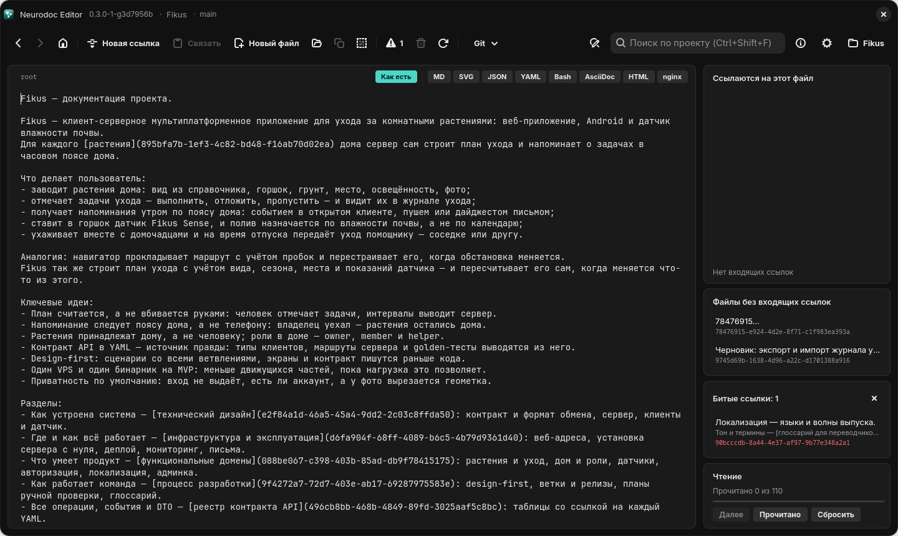

# Редактирование и ссылки

Текст правят как в обычном редакторе, а сохранять ничего не нужно. Здесь — как создавать
файлы и ссылки, как ссылки править и как увидеть их запись целиком.

## Автосохранение

Файл сохраняется сам: через 0,7 секунды после последней правки и при переходе к другому
файлу; на Windows и Linux — ещё при закрытии окна, на Android — когда приложение уходит в фон.
Сохранить сразу на десктопе — <kbd>Ctrl</kbd>+<kbd>S</kbd> или <kbd>F2</kbd>. Файлы пишутся в
UTF-8 без BOM, переводы строк остаются такими, какими были в файле.

## Команды

| Действие | Windows и Linux | Android |
| --- | --- | --- |
| Новая ссылка | «Новая ссылка», <kbd>Ctrl</kbd>+<kbd>T</kbd> | «+» в верхней панели |
| Связать выделение | «Связать», <kbd>Ctrl</kbd>+<kbd>L</kbd> | меню ⋮ → «Связать с ссылкой из буфера» |
| Снять ссылку | <kbd>Ctrl</kbd>+<kbd>U</kbd> | меню ⋮ → «Снять ссылку под курсором» |
| Новый файл | «Новый файл», <kbd>Ctrl</kbd>+<kbd>N</kbd> | меню ⋮ → «Новый файл» |
| Копировать ссылку | значок в панели инструментов | меню ⋮ → «Копировать ссылку» |
| Копировать содержимое | значок в панели инструментов | меню ⋮ → «Копировать содержимое» |
| Удалить файл | значок «Удалить текущий файл» | меню ⋮ → «Удалить файл» |

## Новая ссылка и новый файл

«Новая ссылка» делает три дела разом: вставляет ссылку в позицию каретки, создаёт для неё
файл в `_content/` и открывает его. Текстом ссылки (якорем) становится:

- выделенный текст;
- без выделения — слово, на котором стоит каретка или к которому она примыкает (на Android
  частью слова считается и дефис);
- если слова нет — ничего: получится ссылка без текста ``.

Этот же текст ложится первой строкой нового файла, то есть становится его заголовком:
набрали в оглавлении «Авторизация», нажали <kbd>Ctrl</kbd>+<kbd>T</kbd> — и уже пишете раздел
об авторизации.

Текст ссылки — одна строка без символа `]`, пробелы по краям выделения в него не входят.
Неподходящее выделение (несколько строк или `]` внутри) Windows и Linux не исправляют, а
отказываются и объясняют почему; Android заменяет переводы строк пробелами и выбрасывает `]`.
Так же ведёт себя и «Связать». Внутрь другой ссылки новую не вставить — приложение
предупредит.

«Новый файл» создаёт пустой файл в `_content/` и открывает его. Пока на него никто не
сослался, он виден в списке [«Файлы без входящих ссылок»](panels.md#файлы-без-входящих-ссылок).

## Связать уже написанный текст

Если и текст, и нужный файл уже есть:

1. Откройте файл, на который будет вести ссылка, и нажмите «Копировать ссылку».
2. Вернитесь (<kbd>Alt</kbd>+<kbd>←</kbd>) и выделите слова.
3. Нажмите «Связать» (<kbd>Ctrl</kbd>+<kbd>L</kbd>).

Выделение станет текстом ссылки, а цель возьмётся из буфера обмена — там может лежать
ссылка целиком или одна её цель, например UUID файла. Путь до цели пересчитывается от
текущего файла, поэтому связывать можно и в `root`, и в файлах `_content`.

«Связать» работает в `root` и файлах `_content`, когда текст выделен, а в буфере лежит ссылка
на существующий файл этого каталога; на Windows и Linux без этого кнопка неактивна. Если
выделение задевает другую ссылку, приложение откажется и объяснит почему.
<kbd>Ctrl</kbd>+<kbd>L</kbd> объясняет отказ и тогда, когда кнопка неактивна. На Android
выделение, пропавшее при открытии меню, приложение помнит.

«Копировать ссылку» кладёт в буфер `[заголовок](цель)`. Заголовок — первая непустая строка
файла без ведущих `#` (длинная обрезается до 60 символов с многоточием), у файла в
собственном формате — имя файла; у пустого файла текст ссылки пустой. Цель записана так, как
её пишут в файлах `_content`. Для `root` команда недоступна. «Копировать содержимое» кладёт в
буфер весь текст файла.

## Как править ссылку

В обычном виде служебная часть ссылки скрыта. На Windows и Linux текст ссылки правят прямо
на месте, только каретку в него ставят стрелками: щелчок по ссылке — это переход (на Linux
каретку ставит и щелчок с зажатым <kbd>Ctrl</kbd>). На Android каретку внутрь ссылки в
обычном виде не поставить — ссылку правят в режиме «Как есть». Скрытую цель меняют там же
или снимают ссылку и связывают текст заново.

Снять ссылку, оставив текст: поставьте каретку в ссылку или вплотную к ней и нажмите
<kbd>Ctrl</kbd>+<kbd>U</kbd> (на Android — «Снять ссылку под курсором»). `[текст](цель)`
превратится в `текст`.

## Режим «Как есть»

Кнопка «Как есть» над текстом (на Android — чип под шапкой) показывает файл ровно таким,
каким он лежит на диске: ссылки видны целиком и правятся посимвольно.

*Режим «Как есть»: ссылка записана целиком — текст в квадратных скобках, цель в круглых*

В этом режиме ссылки не перехватывают щелчок и касание, каретка ставится куда угодно. Windows
и Linux ничего не подсвечивают, кроме совпадений поиска; на Android ссылки остаются
цветными. Режим запоминается между запусками и действует на все файлы; как он уживается с
форматами просмотра — в главе [Просмотр форматов](viewers.md).

## Отмена и повтор

На Windows и Linux <kbd>Ctrl</kbd>+<kbd>Z</kbd> отменяет правку, а
<kbd>Ctrl</kbd>+<kbd>Shift</kbd>+<kbd>Z</kbd> повторяет её. <kbd>Ctrl</kbd>+<kbd>Y</kbd> здесь
не повтор, а удаление строки, как в IntelliJ IDEA.

История отмены начинается заново при каждом открытии файла: ушли в другой файл и вернулись —
прежние правки уже не отменить. Снятие ссылки, перенос и удаление строки, замена всех
вхождений в файле отменяются одним шагом. В интерфейсе Android-версии отмены нет.

## Вставка и выделение

- Вставляется только текст; на Windows и Linux его переводы строк приводятся к стилю файла.
- На Linux копирование и вырезание кладут в буфер текст вместе со скрытыми частями ссылок, а
  выделенный текст нельзя перетащить мышью: при переносе потерялись бы цели ссылок.
- На Android долгое нажатие на ссылке открывает её, а не выделяет текст. Чтобы выделить текст,
  начинайте выделение вне ссылки.

Клавиши для работы со строками — отступы, перенос, удаление строки — собраны в главе
[Горячие клавиши](hotkeys.md#правка-текста).

## Ссылки на файлы в собственных форматах

Ссылка может вести не только в `_content/`, но и на YAML, SVG или конфиг из соседней папки
каталога. Тогда вместо UUID в ней записан путь от того файла, где ссылка стоит:

- из файла в `_content/` — `[auth.start](../contract/auth/start.yaml)`;
- из `root` — `[auth.start](contract/auth/start.yaml)`.

Путь удобнее не писать руками: откройте файл, нажмите «Копировать ссылку» и свяжите слова
кнопкой «Связать» — путь пересчитается от текущего файла сам. Вставленная простым текстом в
`root`, скопированная ссылка окажется битой: путь в ней записан для файлов `_content`. На
Android «Связать» не узнаёт в буфере путь вида `../contract/…` — там такую ссылку вписывают
в режиме «Как есть».

Сам файл в собственном формате — только цель ссылок, не источник: «Связать» в нём откажется.
Как такие файлы показываются — в главе [Файлы в собственных форматах](../format/own-formats.md).

## Удаление файла

Удаление спрашивает, что делать со ссылками на файл:

- «Только файл» — ссылки на него останутся и станут [битыми](panels.md#битые-ссылки);
- «Файл и ссылки» — ссылки снимаются во всём каталоге, но их текст остаётся: его писал
  автор, и он часть предложения. Ссылки без текста исчезают целиком.

Удаление безвозвратно, корзины нет; `root` удалить нельзя. Потом открывается `root`, а файл
пропадает из истории «Назад».
