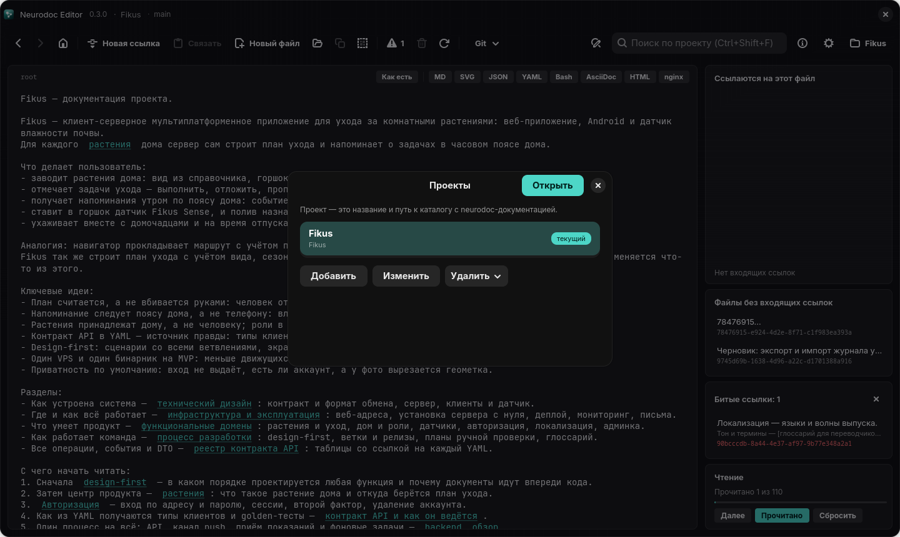
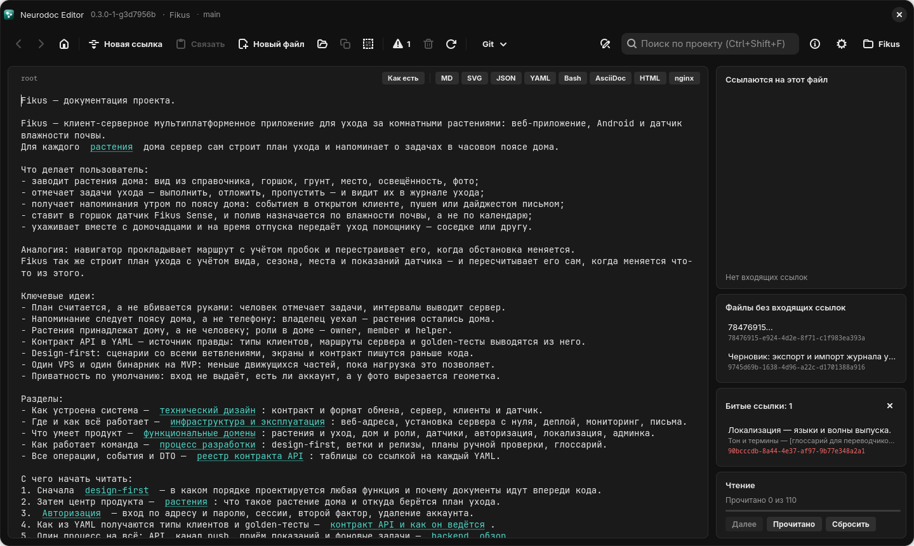

# Первые шаги

Как открыть первый каталог, попробовать редактор на примере из репозитория и разобраться, что
где в окне.

## Первый проект

Редактор работает с проектами: проект — это название и путь к папке каталога neurodoc.
Текущий проект открывается при каждом запуске, а пока его нет, окно показывает «Проект не
выбран» с кнопкой «Открыть список проектов»; Windows и Linux при этом сразу открывают диалог
«Проекты» сами. Android при первом запуске сначала просит доступ к файлам: в окне «Нужен
доступ к файлам» нажмите «Открыть настройки» и разрешите приложению доступ ко всем файлам.



*Диалог «Проекты» в Linux-версии*

1. В диалоге «Проекты» нажмите «Добавить».
2. Впишите «Название» и «Путь к каталогу» или выберите папку кнопкой «Обзор…» (на Android —
   «Выбрать папку…»).
3. Нажмите «Сохранить».

Первый добавленный проект сразу становится текущим и открывается (на Windows и Linux — когда
вы закроете диалог). На Android кнопка «Выбрать папку…» в новом проекте обходится без
«Сохранить»: проект сразу сохраняется под именем выбранной папки и открывается. Остальное о
проектах — в главе [Проекты и настройки](settings.md).

## Новый каталог

Папка проекта может быть пустой или вовсе не существовать — тогда приложение создаст в ней
каталог:

- пустой файл `root` — с него начинается чтение;
- папку `_content/` для остальных файлов;
- `ReadMe.md` с описанием формата.

В уже существующей папке приложение лишь добавляет недостающее из этого списка и больше
ничего не трогает. Как устроен каталог — в главе [Каталог](../format/catalog.md).

В новом каталоге `root` пуст. Напишите в нём оглавление, а файлы для разделов создавайте
кнопкой «Новая ссылка»: она вставит ссылку, создаст файл и откроет его — см.
[Редактирование и ссылки](editing.md).

## Пример: каталог Fikus

В папке `example/` репозитория лежит готовый каталог — документация выдуманного сервиса Fikus
для ухода за комнатными растениями. В нём есть всё, что умеет формат: оглавление и маршрут
чтения в `root`, около сотни файлов в `_content/`, YAML-контракты в `contract/`, схемы,
конфиги и даже одна намеренно битая ссылка. Подробно он разобран в главе
[Каталог Fikus](../example.md).

Редактор сохраняет правки сразу, поэтому откройте не сам `example/`, а его копию. На Linux,
например, так:

```bash
cp -r example ~/fikus
```

— и добавьте `~/fikus` как проект. На Windows скопируйте папку Проводником, на Android — в
память телефона, а затем выберите копию кнопкой «Обзор…» или «Выбрать папку…».

Ещё один готовый каталог — `doc/`: документация самого Neurodoc Editor, тоже в формате
neurodoc. Если не собираетесь её править, её тоже лучше открывать копией.

## Из чего состоит окно



*Главное окно Linux-версии: открыт `root` каталога Fikus, тёмная тема*

Сверху вниз:

- **Строка заголовка** — «Neurodoc Editor», версия приложения, имя проекта и текущая ветка git.
- **Панель инструментов.** Слева — «Назад», «Вперёд» и переход к `root`; затем «Новая
  ссылка», «Связать», «Новый файл» и значки: открыть файл по UUID или пути, копировать
  ссылку на текущий файл, копировать его содержимое. Дальше — битые ссылки со счётчиком,
  удаление файла, перечитывание проекта с диска и меню «Git». Справа — поиск и замена, поле
  «Поиск по проекту», горячие клавиши, настройки и кнопка проектов, подписанная именем
  открытого проекта.
- **Хлебные крошки** — кратчайшие пути от `root` до текущего файла; по любой крошке, кроме
  последней (это сам файл), можно перейти. У `root` и у файлов, до которых от `root` по
  ссылкам не дойти, крошек нет.
- **Карточка редактора.** Слева в её шапке — идентификатор открытого файла: `root`, UUID или
  путь вроде `contract/auth/start.yaml`. Справа — «Как есть» и кнопки форматов «MD», «SVG»,
  «JSON», «YAML», «Bash», «AsciiDoc», «HTML», «nginx» (см. [Просмотр форматов](viewers.md)).
  Ниже — сам текст.
- **Правая колонка** — карточки «Ссылаются на этот файл», «Файлы без входящих ссылок»,
  «Битые ссылки» (появляется, когда они есть) и «Чтение»: счётчик, полоса прогресса и кнопки
  «Далее», «Прочитано», «Сбросить». По запросу сверху добавляются «Результаты поиска» и
  история git. Что показывают крошки и карточки, рассказано в главе
  [Панели графа и порядок чтения](panels.md).

На Android то же собрано по-телефонному:

- в верхней панели — имя проекта и ветка, под ними идентификатор файла; стрелка «Назад»
  слева, справа — «Вперёд», домик (переход к `root`), «+» (новая ссылка) и меню ⋮ со всеми
  остальными командами;
- под ней — крошки, тонкая полоса прогресса чтения и строка чипов: счётчик прочитанного,
  «Прочитано», «Далее», «Как есть» и форматы;
- панели связей открывает пункт меню «Связи файла».

## Что попробовать

- Щёлкните ссылку в `root` — откроется файл, на который она ведёт; вернитесь кнопкой «Назад»
  или <kbd>Alt</kbd>+<kbd>←</kbd>. Дальше — [Навигация](navigation.md).
- Включите «Как есть», чтобы увидеть, как ссылки записаны в файле, —
  [Редактирование и ссылки](editing.md).
- Нажмите <kbd>F1</kbd>: откроется шпаргалка по клавишам (на Android — пункт меню «Справка»).
  Полный список — [Горячие клавиши](hotkeys.md).
