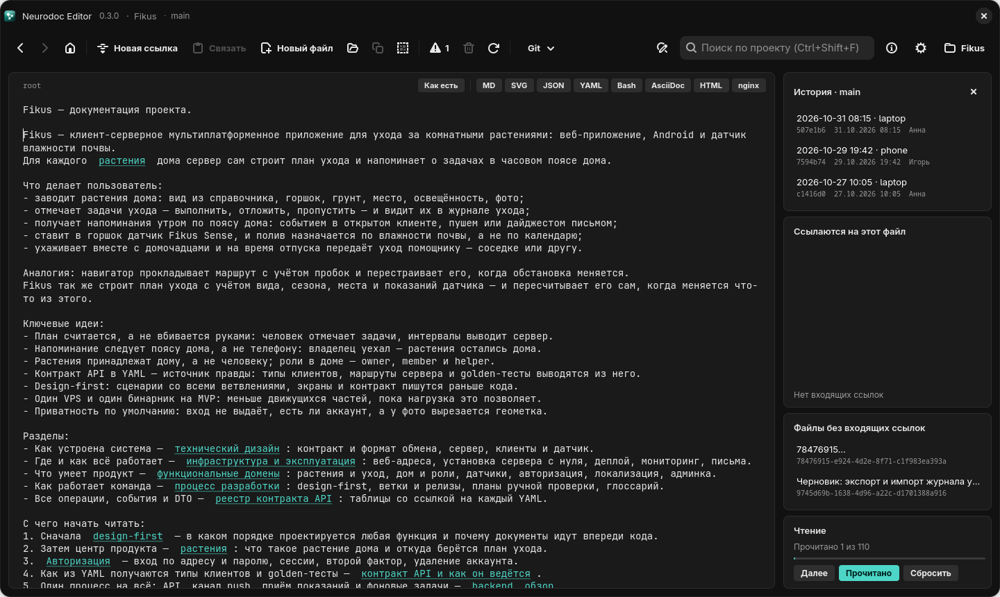
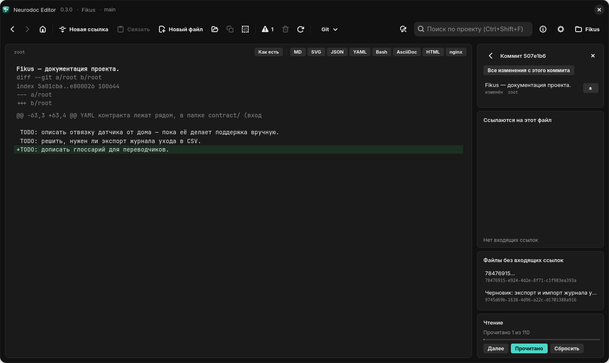

# Совместная работа через git

Каталог neurodoc удобно держать в git-репозитории с общим сервером. Весь рабочий цикл git
встроен во все три версии редактора — терминал для повседневной работы не нужен.

## Где это в интерфейсе

На Windows и Linux — кнопка «Git» в панели инструментов (работает и без проекта: можно начать с
клонирования), ветка — в строке заголовка окна. На Android — пункт «Git…» в меню ⋮, доступный
только при открытом проекте, ветка — в верхней панели. Пункты те же, кроме этих:

| Что | Windows и Linux | Android |
|---|---|---|
| новая ветка | «Ветки» → «Создать ветку…» | «Новая ветка…» |
| удаление ветки | «Ветки» → «Удалить ветку» | значок удаления у ветки |
| публикация | «Опубликовать проект на сервере…» | «Опубликовать проект…» |
| автор и доступ | настройки самого git | «Настройки Git…» |

> [!NOTE]
> Репозиторием приложение считает только папку проекта с `.git` внутри. Каталог в подпапке
> другого репозитория (как `doc/` в Neurodoc) им не считается: git для него недоступен, а
> «Опубликовать…» создало бы в нём вложенный репозиторий.

## Сохранить, получить, синхронизировать

Автосохранение пишет только на диск; на сервер правки уходят операциями git, и каждый коммит
сразу отправляется push.

- **«Сохранить на сервере»** — commit всех правок и push. Нет правок — нет коммита, но push
  всё равно отправит то, что не ушло раньше.
- **«Получить с сервера»** — pull со слиянием: серверные коммиты вливаются в вашу ветку, ваши
  правки остаются незакоммиченными.
- **«Синхронизировать»** — commit, `pull --rebase` (ваши коммиты встают поверх серверных) и
  push. Кнопка на каждый день: непересекающиеся правки проходят без вопросов.

Сообщение коммита шаблонное: дата, время и устройство (имя компьютера на Windows, хоста на
Linux, модель телефона на Android), например `2026-11-03 18:40 · workstation`. Перед операцией
открытый файл сохраняется, после неё каталог перечитывается; если открытого файла не стало
(например, в другой ветке), открывается `root`.

## Опубликовать и клонировать

**Публикация.** Создайте на сервере пустой репозиторий — без README и лицензии: ветка уходит
обычным push, и непустой сервер его отклонит. Затем выберите публикацию и введите адрес.
Приложение создаёт репозиторий с веткой `main` (на десктопе — с выключенным `core.autocrlf`),
коммитит всё как «Initial commit» и отправляет. Windows и Linux заранее проверяют, что в git
заданы `user.name` и `user.email`; на Android сначала заполните «Настройки Git…» — без почты
автора публикация сорвётся на полпути.

Если не удалась отправка (опечатка в адресе, нет доступа), репозиторий уже создан, и пункта
публикации больше нет. На десктопе устраните причину — адрес меняет
`git remote set-url origin <адрес>` — и нажмите «Сохранить на сервере».

**Клонирование.** «Клонировать с сервера…» спрашивает адрес, название проекта (подставляется из
адреса) и папку: «Обзор…» на десктопе, путь вручную на Android. Если папка не пуста, кнопка
«Удалить и клонировать» безвозвратно стирает её содержимое. Каталог добавляется в
[список проектов](settings.md) и открывается.

Без сети всё это можно опробовать на копии каталога и локальном bare-репозитории
(`git init --bare -b main remote.git`, адрес `file:///…/remote.git`; без `-b main` клон может
выйти без файлов) — см. [Проверки](../dev/testing.md).

## Конфликты

Сливать конфликтующие правки приложение не пытается: оно откатывает операцию и спрашивает,
что делать.

| Когда | Выбор |
|---|---|
| «Сохранить на сервере»: на сервере есть коммиты, которых нет у вас | «Мои затирают серверные», «Отмена» |
| «Получить с сервера»: серверные правки конфликтуют с вашими | «Серверные затирают мои», «Отмена» |
| «Синхронизировать»: ваши коммиты не встают поверх серверных | «Взять серверные», «Взять мои», «Отмена» |

Вопрос из первой строки задаёт и «Синхронизировать», если чужие коммиты пришли на сервер, пока
она работала. «Получить с сервера» может вместо вопроса кончиться ошибкой git, если сервер
изменил файл, который вы правите: правки целы, отправьте их «Синхронизировать».

> [!WARNING]
> Серверная версия стирает ваши неотправленные коммиты, правки и новые файлы, которых нет в
> git; своя уходит `push --force` и затирает коммиты коллег. Резервных копий приложение
> намеренно не делает. Сомневаетесь — «Отмена»: она ничего не затирает, а конфликт можно
> разрешить в другом git-клиенте. После отказа «Сохранить на сервере» берите
> «Синхронизировать», особенно на Android: неудачное «Получить с сервера» там откатывается к
> последнему коммиту, и правки, сделанные после отказа, пропадают ещё до вопроса.

## Ветки

В подменю «Ветки» (на Android — раздел диалога) — локальные ветки, текущая отмечена; щелчок по
другой переключает на неё. Ветка коллеги появится там после `git fetch` и `git switch <имя>`
в терминале.

- **Правки не едут за вами**: при переключении они прячутся в stash с меткой
  `neurodoc-auto:<ветка>`, вместе с новыми файлами, и возвращаются, когда вы вернётесь.
- **Новая ветка** создаётся от текущей и сразу отправляется на сервер, текущие правки переходят
  в неё. В имени нельзя пробелы и символы `~ ^ : ? * [ \`.
- **Удаление** стирает ветку и локально, и на сервере. Основная ветка не предлагается, с текущей
  приложение сначала уходит на основную. Неотправленное из удаляемой ветки пропадает вместе с
  её stash.

## История и дельты

«История коммитов» открывает карточку «История · ветка» — в правой колонке, на Android панелью
под редактором: до 200 последних коммитов ветки, новые сверху, с хэшем, датой и автором.



*История коммитов текущей ветки*

Щелчок по коммиту показывает его файлы — с заголовками, а не UUID, со статусом и путём. Файлы
с точкой в начале имени (`.gitignore`) скрыты, заголовок удалённого файла берётся из прежней
ревизии. Щелчок по файлу открывает его.

- **«Все изменения с этого коммита»** расширяет список до всего, что изменилось с коммита до
  текущего состояния, включая неотправленное.
- **«±»** показывает дельту на месте редактора: добавленное зелёным, удалённое красным. К тексту
  возвращает выбор формата; на десктопе — ещё повторное «±» или переход к другому файлу, на
  Android — крестик.



*Дельта файла в выбранном коммите*

## Учётные данные

Windows и Linux работают через системный git (на Windows — Git for Windows) с его ключами,
помощником учётных данных и именем автора. Запрос пароля в терминале отключён
(`GIT_TERMINAL_PROMPT=0`): без готового доступа git вернёт ошибку, а не повиснет в ожидании
ввода. Настройте его в терминале заранее. На Linux проще всего SSH-ключи через агент, для
HTTPS нужен помощник (на Fedora — пакет `git-credential-libsecret`):

```bash
git config --global credential.helper libsecret
```

На Android системного git нет: встроенный клиент JGit ходит по HTTPS с токеном, без SSH.
В «Настройки Git…» задаются «Имя автора коммитов» (пусто — модель телефона), обязательная
«Почта автора коммитов», «Токен github.com» и «Токен gitlab.com» (Personal Access Token на
чтение и запись; для других серверов полей нет). Имя пользователя для токена подставляется
само. Токены лежат в настройках открытым текстом; в облачный бэкап и на новый телефон они
не попадают.
