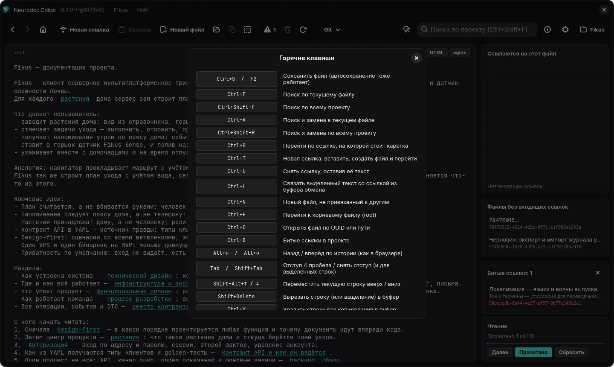

# Горячие клавиши

На Windows и Linux сочетания клавиш одинаковые. Шпаргалку в самом приложении
открывает <kbd>F1</kbd> или кнопка «Горячие клавиши (F1)» справа на панели
инструментов. Android-версия своих сочетаний не задаёт: те же действия там вынесены в
верхнюю панель и меню ⋮, соответствие собрано в конце главы.

*Шпаргалка «Горячие клавиши» в Linux-версии*

В таблицах ниже есть всё, что показывает шпаргалка, и несколько клавиш, которые в неё не
попали. В колонке «Где» сказано, где работает сочетание: «везде» — не только в тексте,
но и в других местах окна, «в редакторе» — только когда фокус ввода в тексте.

## Файлы и навигация

| Сочетание | Действие | Где |
| --- | --- | --- |
| <kbd>Ctrl</kbd>+<kbd>S</kbd> / <kbd>F2</kbd> | Сохранить файл (автосохранение тоже работает) | везде |
| <kbd>Ctrl</kbd>+<kbd>N</kbd> | Новый файл, не привязанный к другим | везде |
| <kbd>Ctrl</kbd>+<kbd>O</kbd> | Открыть файл по UUID или пути | везде |
| <kbd>Ctrl</kbd>+<kbd>H</kbd> | Перейти к корневому файлу (root) | везде |
| <kbd>Alt</kbd>+<kbd>←</kbd> / <kbd>Alt</kbd>+<kbd>→</kbd> | Назад / вперёд по истории (как в браузере) | везде |
| <kbd>F5</kbd> | Перечитать проект с диска | везде |
| <kbd>F1</kbd> | Шпаргалка по горячим клавишам | везде |

## Ссылки

| Сочетание | Действие | Где |
| --- | --- | --- |
| <kbd>Ctrl</kbd>+<kbd>T</kbd> | Новая ссылка: вставить, создать файл и перейти | везде |
| <kbd>Ctrl</kbd>+<kbd>G</kbd> | Перейти по ссылке, на которой стоит каретка | в редакторе |
| <kbd>Ctrl</kbd>+<kbd>L</kbd> | Связать выделенный текст со ссылкой из буфера обмена | в редакторе |
| <kbd>Ctrl</kbd>+<kbd>U</kbd> | Снять ссылку, оставив её текст | в редакторе |
| <kbd>Ctrl</kbd>+<kbd>B</kbd> | Показать или скрыть карточку «Битые ссылки» | везде |
| щелчок по ссылке | Переход к файлу `[текст](цель)`; адреса `http(s)` открываются в браузере | в редакторе |

Как устроены ссылки и что делают эти команды, рассказано в главе [Редактирование и
ссылки](editing.md), а про карточку битых ссылок — в главе [Панели графа и порядок
чтения](panels.md).

## Поиск и замена

| Сочетание | Действие | Где |
| --- | --- | --- |
| <kbd>Ctrl</kbd>+<kbd>F</kbd> | Поиск по текущему файлу | везде |
| <kbd>Enter</kbd> / <kbd>Shift</kbd>+<kbd>Enter</kbd> | Следующее / предыдущее совпадение | в панели поиска по файлу |
| <kbd>Esc</kbd> | Закрыть панель поиска по файлу | в панели поиска; на Linux и в редакторе |
| <kbd>Ctrl</kbd>+<kbd>Shift</kbd>+<kbd>F</kbd> | Поиск по всему проекту: фокус переходит в поле поиска | везде |
| <kbd>Enter</kbd> | Искать по проекту | в поле поиска по проекту |
| <kbd>Esc</kbd> | Вернуться из поля поиска в редактор | в поле поиска по проекту |
| <kbd>Ctrl</kbd>+<kbd>R</kbd> | Поиск и замена в текущем файле | везде |
| <kbd>Ctrl</kbd>+<kbd>Shift</kbd>+<kbd>R</kbd> | Поиск и замена по всему проекту | везде |

Подробности — в главе [Поиск и замена](search.md).

## Правка текста

| Сочетание | Действие | Где |
| --- | --- | --- |
| <kbd>Enter</kbd> | Новая строка с сохранением отступа | в редакторе |
| <kbd>Tab</kbd> / <kbd>Shift</kbd>+<kbd>Tab</kbd> | Отступ 4 пробела / снять отступ (и для выделенных строк) | в редакторе |
| <kbd>Shift</kbd>+<kbd>Alt</kbd>+<kbd>↑</kbd> / <kbd>↓</kbd> | Переместить текущую строку вверх / вниз | в редакторе |
| <kbd>Shift</kbd>+<kbd>Delete</kbd> | Вырезать строку (или выделение) в буфер | в редакторе |
| <kbd>Ctrl</kbd>+<kbd>Y</kbd> | Удалить строку без копирования в буфер | в редакторе |
| <kbd>Ctrl</kbd>+<kbd>Z</kbd> / <kbd>Ctrl</kbd>+<kbd>Shift</kbd>+<kbd>Z</kbd> | Отменить / повторить | в редакторе |

<kbd>Tab</kbd> вставляет пробелы, а не символ табуляции. <kbd>Shift</kbd>+<kbd>Delete</kbd>
без выделения вырезает всю текущую строку, с выделением — только выделенное.

## Что стоит знать

- **<kbd>Ctrl</kbd>+<kbd>Y</kbd> — не повтор.** Как в IntelliJ IDEA, это удаление
  строки. Повтор отменённого — <kbd>Ctrl</kbd>+<kbd>Shift</kbd>+<kbd>Z</kbd>.
- **Сочетания текстовых процессоров не форматируют текст.** Файлы neurodoc — простой
  текст, поэтому <kbd>Ctrl</kbd>+<kbd>B</kbd>, <kbd>Ctrl</kbd>+<kbd>U</kbd>,
  <kbd>Ctrl</kbd>+<kbd>L</kbd> и <kbd>Ctrl</kbd>+<kbd>R</kbd> заняты командами
  редактора, а не полужирным, подчёркиванием и выравниванием.
- **Отмена касается только текста.** <kbd>Ctrl</kbd>+<kbd>Z</kbd> и
  <kbd>Ctrl</kbd>+<kbd>Shift</kbd>+<kbd>Z</kbd> отменяют и повторяют правки, но не
  трогают оформление: свёрнутая ссылка от отмены не развернётся.
- **История отмены не переходит между файлами.** Она начинается заново при каждом
  открытии файла: <kbd>Ctrl</kbd>+<kbd>Z</kbd> не вернёт правки предыдущего файла, а
  после возврата в файл — и сделанные в нём раньше (см.
  [Редактирование и ссылки](editing.md#отмена-и-повтор)).
- **Сочетания работают и в русской раскладке**: важна клавиша, а не буква на ней.
- **Особенности Linux.** Пока открыт диалог, сочетания окна (сохранение, поиск, переходы)
  не действуют. Щелчок по ссылке с нажатым <kbd>Shift</kbd> или <kbd>Ctrl</kbd> не
  переходит по ней и работает как обычный щелчок по тексту.
- **Подсказки кнопок напоминают сочетания.** Например, «Назад (Alt+←)», «Перейти к
  корневому файлу (Ctrl+H)», «Поиск и замена (Ctrl+R)».

## Android

На Android те же действия вынесены в верхнюю панель и меню ⋮:

| На десктопе | На Android |
| --- | --- |
| <kbd>Alt</kbd>+<kbd>←</kbd> / <kbd>Alt</kbd>+<kbd>→</kbd> | стрелки «Назад» и «Вперёд» в верхней панели |
| <kbd>Ctrl</kbd>+<kbd>H</kbd> | домик в верхней панели |
| <kbd>Ctrl</kbd>+<kbd>T</kbd> | «+» в верхней панели |
| <kbd>Ctrl</kbd>+<kbd>N</kbd> | ⋮ → «Новый файл» |
| <kbd>Ctrl</kbd>+<kbd>O</kbd> | ⋮ → «Открыть по UUID или пути» |
| <kbd>Ctrl</kbd>+<kbd>L</kbd> | ⋮ → «Связать с ссылкой из буфера» |
| <kbd>Ctrl</kbd>+<kbd>U</kbd> | ⋮ → «Снять ссылку под курсором» |
| <kbd>Ctrl</kbd>+<kbd>F</kbd> | ⋮ → «Поиск в файле» |
| <kbd>Ctrl</kbd>+<kbd>Shift</kbd>+<kbd>F</kbd> | ⋮ → «Поиск по проекту» |
| <kbd>Ctrl</kbd>+<kbd>R</kbd>, <kbd>Ctrl</kbd>+<kbd>Shift</kbd>+<kbd>R</kbd> | ⋮ → «Поиск и замена», область выбирается в окне |
| <kbd>Ctrl</kbd>+<kbd>B</kbd> | ⋮ → «Связи файла», раздел «Битые ссылки» |
| <kbd>F5</kbd> | ⋮ → «Обновить с диска» |
| <kbd>F1</kbd> | ⋮ → «Справка» |
| <kbd>Ctrl</kbd>+<kbd>G</kbd>, щелчок по ссылке | касание ссылки |
| <kbd>Ctrl</kbd>+<kbd>S</kbd> | не нужно: автосохранение плюс сохранение, когда приложение уходит в фон |

Чисто клавиатурных операций на Android нет: отступов <kbd>Tab</kbd>, перемещения строк
<kbd>Shift</kbd>+<kbd>Alt</kbd>+<kbd>↑</kbd>/<kbd>↓</kbd>, удаления строки
<kbd>Ctrl</kbd>+<kbd>Y</kbd> и <kbd>Shift</kbd>+<kbd>Delete</kbd>, сохранения отступа
по <kbd>Enter</kbd>.
