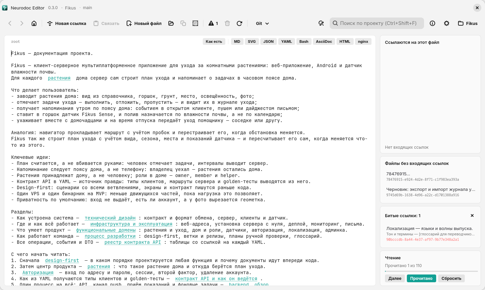

# Neurodoc Editor

Neurodoc Editor — редактор каталогов в [формате neurodoc](../format/index.md). Каталог в нём
читают как сайт в браузере: щёлкнули по ссылке — открылся файл, «Назад» вернул туда, где были.
А правят как в IDE: сохранять ничего не нужно, правки записываются на диск сами.

*Linux-версия в светлой теме: открыт `root` каталога-примера Fikus*

## Три версии

| Платформа | На чём написана | Код |
| --- | --- | --- |
| Windows 11 | C# / .NET 10, WinUI 3 (Windows App SDK). Обычный exe без MSIX-пакета (unpackaged); папка, собранная скриптом деплоя, несёт рантайм с собой (self-contained). Просмотр форматов — WebView2 | [`windows/`](https://github.com/vabuter/neurodoc/tree/main/windows) |
| Linux | Rust, GTK4 и libadwaita, просмотр форматов — WebKitGTK | [`linux/`](https://github.com/vabuter/neurodoc/tree/main/linux) |
| Android 11 и новее | Kotlin, Jetpack Compose (Material 3), просмотр форматов — WebView, git — встроенный JGit | [`android/`](https://github.com/vabuter/neurodoc/tree/main/android) |

Готовых сборок пока нет: приложение собирают из исходников скриптами из репозитория — об этом
глава [Установка](install.md).

## Что у них общего

- **Одна функциональность.** Пользовательские истории у всех трёх версий одинаковые: правку
  формата или поведения доводят до каждой.
- **Одно ядро.** Linux- и Android-версии — порты того же домена, что и Windows-версия: тот же
  разбор ссылок, те же панели графа, тот же порядок чтения. Если версии считают что-то
  по-разному, это ошибка, а не «особенность платформы».
- **Один интерфейс.** Windows- и Linux-версии совпадают вплоть до порядка кнопок и сочетаний
  клавиш, Android даёт те же команды в телефонной компоновке. Просмотр форматов (Markdown,
  SVG, YAML…) у всех трёх строится одними и теми же встроенными библиотеками и работает без
  интернета.

## Чем отличается Android

Функции те же, средства другие — телефон не десктоп:

- своих сочетаний клавиш нет: команды собраны в верхней панели, строке чипов под ней и
  меню ⋮;
- нет клавиатурных операций со строками — перемещения строки, отступов <kbd>Tab</kbd>,
  удаления строки, — а в интерфейсе нет отмены и повтора;
- панели связей (входящие ссылки, битые ссылки, файлы без входящих ссылок) открывает пункт
  меню «Связи файла», а прогресс чтения показан тонкой полосой под шапкой и чипами «Прочитано»
  и «Далее»;
- за диском приложение не следит: правки других программ подхватывает пункт «Обновить с диска»;
- git встроен в само приложение и авторизуется токеном; Windows и Linux пользуются системным
  git и его учётными данными.

**Версия приложения видна в разных местах — намеренно.** На Windows и Linux она в строке
заголовка окна, сразу после названия; на Android — внизу диалога «Настройки», потому что
верхнюю панель телефона занимает имя проекта. Откуда берётся номер версии, рассказано в главе
[Версии и выпуски](../dev/versioning.md).

## Что в этом разделе

- [Установка](install.md) — сборка и установка на Windows, Linux и Android.
- [Первые шаги](first-steps.md) — первый проект, пример Fikus и устройство окна.
- [Навигация](navigation.md) — переходы по ссылкам, история, «Открыть файл», «Далее».
- [Редактирование и ссылки](editing.md) — автосохранение, новые файлы и ссылки, режим «Как есть».
- [Просмотр форматов](viewers.md) — Markdown, SVG, YAML и другие форматы.
- [Поиск и замена](search.md) — по файлу и по всему проекту.
- [Панели графа и порядок чтения](panels.md) — входящие и битые ссылки, сироты, прогресс.
- [Совместная работа через git](git.md) — сохранить, получить, синхронизировать, история.
- [Проекты и настройки](settings.md), [Горячие клавиши](hotkeys.md) и
  [Переход со старого формата ссылок](migration.md).
