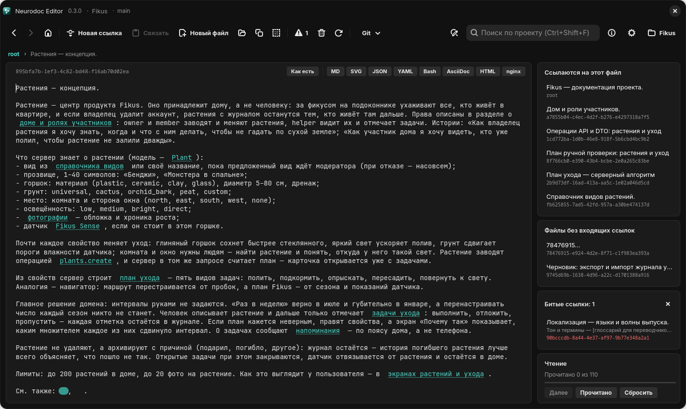
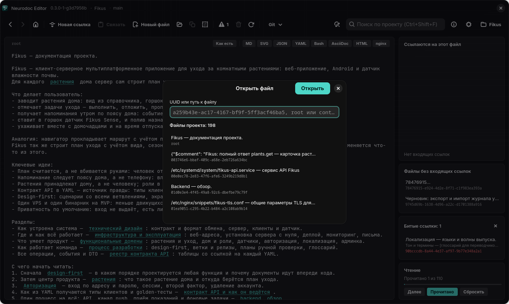

# Навигация

Каталог читают как сайт: щелчок по ссылке открывает файл, «Назад» возвращает туда, где вы
были, а редактор помнит, где вы остановились в каждом файле.

## Переход по ссылке

На Windows и Linux по ссылке щёлкают: над ней курсор превращается в «руку», а подсказка
показывает заголовок файла, на который она ведёт. На Android по ссылке касаются.

*Файл, открытый щелчком по ссылке из `root`*

Как ссылки выглядят в тексте:

- `[текст](цель)` — подчёркнутый текст, служебная часть скрыта;
- `` — ссылка без текста — кружок (на Android — значок ●);
- ссылки на файлы, которые вы уже прочитали, серые — как посещённые ссылки в браузере;
- адреса `http://` и `https://` подсвечены и открываются в браузере.

<kbd>Ctrl</kbd>+<kbd>G</kbd> (Windows, Linux) переходит по ссылке, на которой стоит каретка, —
внутри неё или вплотную к её краю. На Linux щелчок по ссылке с зажатым <kbd>Ctrl</kbd> или
<kbd>Shift</kbd> перехода не делает: его обрабатывает текстовое поле — ставит каретку в ссылку
или продлевает выделение. В режиме «Как есть» щелчок и касание по ссылке никуда не ведут —
это режим правки, — но <kbd>Ctrl</kbd>+<kbd>G</kbd> работает и в нём.

Ссылка на файл, которого нет, тоже открывается — пустой страницей; если начать в ней писать,
автосохранение создаст файл. Все такие ссылки собирает карточка «Битые ссылки» — см.
[Панели графа и порядок чтения](panels.md). Ссылка, ведущая за пределы каталога, не
подсвечивается вовсе и сразу попадает в битые (см. [Ссылки](../format/links.md#только-внутрь-каталога)).

## Назад, вперёд, к `root`

| | Windows и Linux | Android |
| --- | --- | --- |
| Назад | кнопка «Назад», <kbd>Alt</kbd>+<kbd>←</kbd> | стрелка слева в верхней панели |
| Вперёд | кнопка «Вперёд», <kbd>Alt</kbd>+<kbd>→</kbd> | стрелка справа в верхней панели |
| К `root` | кнопка с домиком, <kbd>Ctrl</kbd>+<kbd>H</kbd> | домик в верхней панели |

История устроена как в браузере:

- в неё попадает любой переход — по ссылке, крошкам, спискам в правой колонке, результатам
  поиска, кнопками «Далее», «Новая ссылка», «Новый файл», домиком, через «Открыть файл»;
- новый переход стирает историю «вперёд»;
- файлы, которых больше нет, пропускаются, а кнопка неактивна, если идти некуда;
- история живёт до смены проекта или закрытия приложения.

## Место в файле запоминается

Уходя из файла, редактор запоминает положение каретки, прокрутку и режим показа: текст или
один из форматов — MD, SVG и другие. Возвращаясь в файл любым путём, не только кнопкой
«Назад», вы увидите его в том же режиме, а текст — с того же места и с кареткой там, где она
стояла. Память живёт до смены проекта или закрытия приложения.

Запомненный режим важнее расширения: если у файла `.md` вы выключили отрисовку, при
возвращении он снова откроется текстом (подробнее — [Просмотр форматов](viewers.md)).

Windows-версия возвращает прокрутку, только если текст лёг так же, как раньше: та же ширина
окна, шрифт, интервал и режим «Как есть». Иначе прежнее смещение указывало бы на случайное
место, и она просто показывает каретку.

## Открыть файл по UUID или пути

<kbd>Ctrl</kbd>+<kbd>O</kbd> или значок «Открыть файл по UUID или пути» в панели
инструментов; на Android — меню ⋮ → «Открыть по UUID или пути».

*Диалог «Открыть файл»: поле ввода и список файлов проекта*

В поле «UUID или путь к файлу» можно ввести:

- UUID файла из `_content/` — сам по себе или внутри текста, например целую ссылку
  `[текст](uuid)`;
- `root`;
- путь к файлу в собственном формате от корня каталога: `contract/auth/start.yaml`.

Под полем сразу видно, нашёлся ли файл: показан его заголовок либо «Файла … нет в этом
проекте.» или «Это не UUID и не путь к файлу проекта.». Ниже — список файлов проекта; он
фильтруется по мере ввода, по имени и по заголовку. Открывает кнопка «Открыть»; в списке —
двойной щелчок, на Android — касание строки. Если в буфере обмена лежит UUID файла этого
проекта — например, скопированная ссылка на него, — он подставится в поле сам.

## «Далее» — по порядку чтения

Кнопка «Далее» в карточке «Чтение» (на Android — чип «Далее») открывает первый ещё не
прочитанный файл по маршруту чтения — обходу каталога от `root` по ссылкам в порядке текста;
текущий файл при этом не в счёт. Пока текущий файл не отмечен прочитанным, «Далее» неактивна.
Отметка ставится сама, если пробыть в файле три секунды, или вручную кнопкой «Прочитано»;
файлы в собственных форматах в маршрут не входят и «Далее» не задерживают. Как строится
маршрут — в главе [Панели графа и порядок чтения](panels.md).

## Правки с диска

Каталог меняют и другие программы: `git pull` в терминале, другой редактор. Windows- и
Linux-версии следят за папкой проекта и подхватывают такие правки сами — через полсекунды
после того, как изменения на диске затихнут. Собственные автосохранения перечитывания не
вызывают: редактор сравнивает содержимое файлов на диске с тем, что держит в памяти.

- Открытый файл перезагружается, только если в нём нет ваших несохранённых правок: чужой текст
  их не затирает. Каретка остаётся на той же позиции.
- Пока идёт git-операция самого приложения, слежение молчит, а каталог перечитывается по её
  окончании.
- Перечитать проект вручную — значок «Перечитать проект с диска» или <kbd>F5</kbd>. Это
  нужно, например, если слежение отвалилось вместе с сетевым диском.

Android-версия за диском не следит. Правки других программ подхватывает пункт меню «Обновить
с диска»; перед перечитыванием он сохраняет ваши правки. После своих git-операций приложение
перечитывает каталог само.
