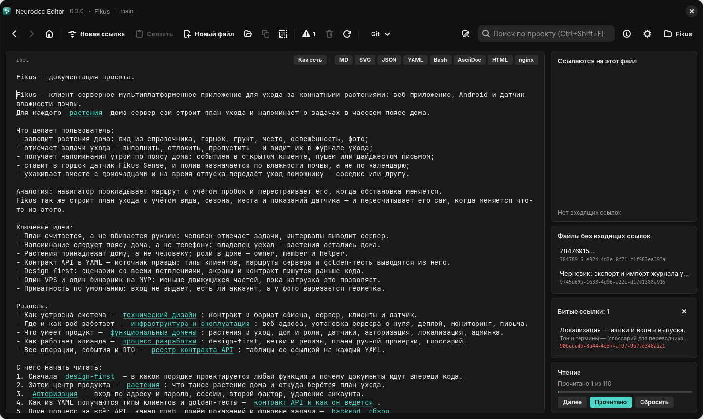

# Панели графа и порядок чтения

Файлы каталога связаны ссылками и вместе образуют граф с корнем в `root` (см. [Граф
знаний](../format/graph.md)). Редактор показывает этот граф вокруг текущего файла: как до
него дойти от `root`, кто на него ссылается, какие файлы потерялись и какие ссылки ведут
в никуда. Рядом показан порядок чтения всего каталога и ваш прогресс в нём.

## Где что находится

На Windows и Linux пути от `root` занимают полосу над редактором во всю ширину окна, а
остальное собрано карточками в правой колонке, сверху вниз:

| Карточка | Что в ней |
| --- | --- |
| «Ссылаются на этот файл» | обратные ссылки на текущий файл |
| «Файлы без входящих ссылок» | файлы, на которые никто не ссылается |
| «Битые ссылки» | ссылки на несуществующие файлы; появляется сама, когда такие ссылки есть |
| «Чтение» | прогресс чтения и кнопки «Далее», «Прочитано», «Сбросить» |

Над ними по мере надобности появляются карточки с результатами поиска по проекту и с
историей git.

На Android пути от `root` идут под верхней панелью. Обратные ссылки, битые ссылки и
файлы без входящих ссылок открываются пунктом меню ⋮ «Связи файла». Прогресс показан
тонкой полосой над строкой чипов, где стоят «Прочитано» и «Далее».

Все панели пересчитываются при каждом переходе, после каждого автосохранения и когда
приложение подхватывает правки с диска.

## Пути от root

Над текстом показаны кратчайшие пути от `root` до текущего файла, по строке на путь,
например:

```text
root › Архитектура › Авторизация › start.yaml
```

- Если кратчайших путей одинаковой длины несколько, показываются все, до 50 штук. На
  Android видны первые три.
- Первый шаг всегда подписан `root`, остальные — заголовком файла: его первой непустой
  строкой без `#` в начале, обрезанной до 36 символов. У файла в собственном формате
  заголовком служит имя файла, например `start.yaml`.
- Щелчок по любому шагу, кроме последнего, открывает этот файл.
- Длинные пути прокручиваются по горизонтали, в том числе колесом мыши.
- Полосы нет у самого `root` и у файлов, до которых от `root` по ссылкам не дойти.

Показываются именно кратчайшие пути. Это самый короткий маршрут, которым читатель
может прийти к файлу от главной страницы.

## Ссылаются на этот файл

Карточка перечисляет файлы, в которых есть ссылка на текущий: заголовок и под ним id
файла, по алфавиту заголовков. Щелчок открывает файл. Если ссылок нет, написано «Нет
входящих ссылок».

Источниками считаются только neurodoc-файлы, то есть `root` и файлы `_content`. Если
в YAML-контракте или в `README.md` встретится текст вида `[что-то](куда-то)`, панели его
не учитывают: файлы в собственных форматах бывают только целями ссылок.

Ссылки разбираются по-настоящему, с учётом того, где они написаны. Один и тот же
контракт из `root` адресуется как `contract/auth/start.yaml`, а из `_content` — как
`../contract/auth/start.yaml`, и в список попадут оба файла (подробнее — в главе
[Ссылки](../format/links.md)).

## Файлы без входящих ссылок

Здесь собраны neurodoc-файлы, на которые не ссылается ни один другой файл (ссылка файла
на самого себя не в счёт). `root` сюда не попадает никогда, файлы в собственных форматах
тоже: контракт или конфиг без ссылок на него — нормальное дело.

В аккуратном каталоге карточка пуста и показывает «Нет таких файлов». До файла из списка
читатель по ссылкам не доберётся, а в порядке чтения такой файл стоит в конце.
Обычно сюда попадают:

- файлы, созданные кнопкой «Новый файл» (<kbd>Ctrl</kbd>+<kbd>N</kbd>), пока на них
  ещё не сослались;
- черновики и файлы, ссылку на которые удалили.

В примере Fikus в этом списке есть пустой файл и черновик.

## Битые ссылки



*Карточка «Битые ссылки»: файл, строка со ссылкой и её цель*

Битой считается ссылка, у которой:

- цель не существует в каталоге;
- цель отвергнута: путь ведёт выше корня каталога, абсолютный или содержит двоеточие —
  букву диска, `mailto:` (см. [Ссылки](../format/links.md#только-внутрь-каталога)).

Адреса `http(s)://…` битыми не бывают. Проверяются только ссылки в `root` и `_content`.
Каждое вхождение — отдельная запись: если на несуществующий файл ссылаются из трёх мест,
записей будет три.

На Windows и Linux число битых ссылок видно на кнопке со значком предупреждения на панели
инструментов. Пока
битые ссылки есть, карточка появляется сама, а в её заголовке написано «Битые ссылки:
N». Если её скрыть крестиком, она не появится, пока вы не откроете её снова кнопкой или
сочетанием <kbd>Ctrl</kbd>+<kbd>B</kbd>. <kbd>Ctrl</kbd>+<kbd>B</kbd> работает как
переключатель: карточка то показывается, то прячется.

В каждой записи три строки: заголовок файла, где стоит ссылка, сама строка текста
(до 70 символов) и цель ссылки. Щелчок открывает файл и выделяет место ссылки, дальше её
можно исправить или снять.

В примере Fikus одна ссылка битая намеренно: она ведёт на документ, который только
запланирован.

На Android битые ссылки показываются в «Связях файла» разделом «Битые ссылки: N», если
они есть. Касание записи открывает файл на месте ссылки.

## Порядок чтения

Каталог задуман для чтения от `root`, и приложение строит маршрут через весь каталог:

1. начинает с `root`;
2. идёт по ссылкам в том порядке, в каком они написаны в тексте, и сначала дочитывает
   ветку до конца, а потом возвращается (обход в глубину);
3. каждый файл встречается в маршруте один раз;
4. в конец добавляет файлы, до которых от `root` по ссылкам не добраться: иначе
   «прочитать всё» было бы невозможно.

В маршрут входят только neurodoc-файлы. Контракты, конфиги и прочие файлы в
собственных форматах — справочные данные: их открывают по мере надобности, а не подряд.
Точный алгоритм — в главе [Граф знаний](../format/graph.md#порядок-чтения).

Маршрут не хранится, а строится заново. Новый файл сразу появляется в нём
непрочитанным.

## Прогресс чтения

Карточка «Чтение» показывает «Прочитано N из M» и полосу прогресса.

- Файл отмечается прочитанным сам, если пробыть в нём 3 секунды. Если уйти раньше,
  отметки не будет: случайный переход по ссылке не засчитывается.
- Кнопка «Прочитано» ставит и снимает отметку вручную.
- У файлов в собственных форматах кнопка «Прочитано» недоступна: они вне маршрута.
- Ссылки на прочитанные файлы показываются серыми, как посещённые ссылки в браузере.

Кнопка «Далее» открывает следующий непрочитанный файл по маршруту, текущий при этом не
в счёт. Она недоступна, пока текущий файл не отмечен прочитанным: «Далее» — это шаг
вперёд по маршруту, и уход из недочитанного файла оставил бы дыру, к которой придётся
возвращаться. Файлы в собственных форматах кнопку не держат. Когда непрочитанных файлов
не осталось, «Далее» тоже недоступна.

«Сбросить» забывает прогресс текущего проекта. Перед этим приложение спрашивает
«Сбросить прогресс чтения?». Сама документация от сброса не меняется.

Прогресс — состояние читателя, а не документации. Он хранится отдельным файлом на
проект рядом с настройками приложения (см. [Проекты и настройки](settings.md)), а в
каталог и в git не попадает. У каждого, кто читает каталог, свой прогресс.

На Android счётчик «N/M» стоит в начале строки чипов, а прогресс сбрасывается пунктом
меню ⋮ «Сбросить прогресс чтения» сразу, без вопроса.
