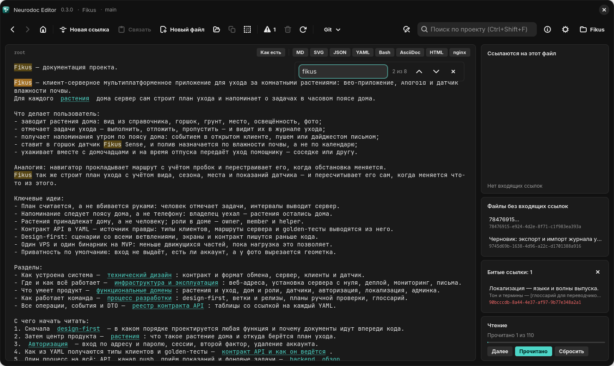
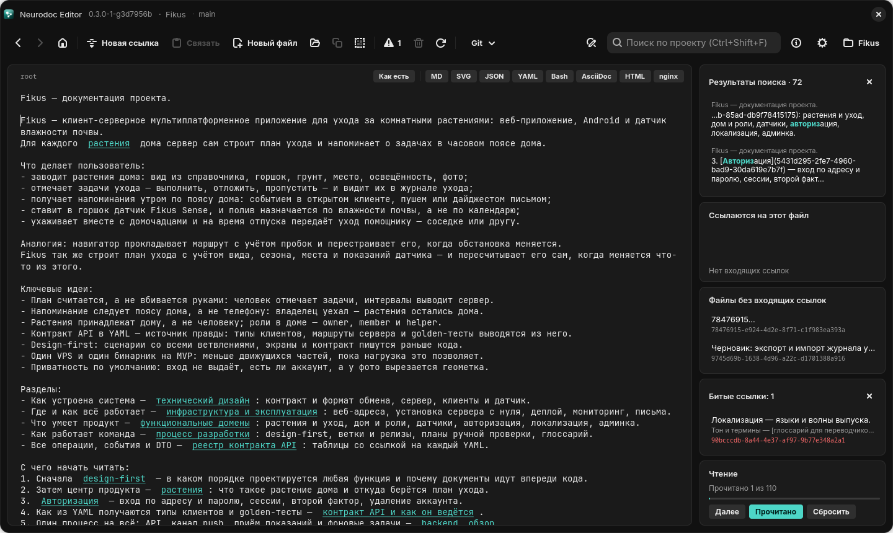

# Поиск и замена

В редакторе три инструмента: поиск по текущему файлу, поиск по всему проекту и «Поиск и
замена». Все они ищут обычную подстроку без учёта регистра, в том числе в кириллице.
Регулярных выражений нет: точка, звёздочка и скобки в запросе означают сами себя.

## Поиск по файлу

<kbd>Ctrl</kbd>+<kbd>F</kbd> открывает панель поиска в правом верхнем углу редактора:
поле «Найти в файле», счётчик и три кнопки.

*Панель поиска по файлу: совпадения подсвечены, текущее выделено ярче*

- Поиск идёт уже при наборе: выделяется первое совпадение от каретки вперёд, а если
  дальше его нет — первое с начала файла (на Android — всегда первое в файле).
- <kbd>Enter</kbd> или кнопка «Следующее (Enter)» ведут к следующему совпадению,
  <kbd>Shift</kbd>+<kbd>Enter</kbd> или «Предыдущее (Shift+Enter)» — к предыдущему.
  После последнего совпадения поиск продолжается с начала.
- Счётчик показывает «3 из 12», когда выделено одно из совпадений, просто их число, пока
  ни одно не выбрано (например, сразу после правки текста), и «0», если ничего не
  найдено.
- Все совпадения подсвечиваются, текущее выделено заметнее остальных.
- <kbd>Esc</kbd> или кнопка «Закрыть (Esc)» убирают панель и подсветку и возвращают
  фокус в текст. На Linux <kbd>Esc</kbd> закрывает панель и из самого редактора.

Если файл был открыт в отрисованном виде (MD, SVG, YAML и т. д.), на Windows и Linux
поиск переключает его обратно в текст: искать можно только там.

> [!TIP]
> Поиск идёт по всему тексту файла, включая скрытую часть ссылок — цель `(uuid)` или
> путь. Если счётчик видит совпадение, а глаз нет, включите «Как есть»: ссылки
> развернутся, а подсветка совпадений в этом режиме остаётся.

На Android панель открывается пунктом меню ⋮ «Поиск в файле» и встаёт над текстом: поле
«Найти в файле», счётчик и кнопки «Предыдущее», «Следующее», «Закрыть».

## Поиск по проекту

<kbd>Ctrl</kbd>+<kbd>Shift</kbd>+<kbd>F</kbd> переводит фокус в поле «Поиск по проекту
(Ctrl+Shift+F)» справа на панели инструментов. Наберите запрос и нажмите
<kbd>Enter</kbd>, а <kbd>Esc</kbd> вернёт фокус в редактор. Пробелы в начале и в конце
запроса отбрасываются.

*Результаты поиска по проекту в правой колонке*

Результаты появляются карточкой вверху правой колонки:

- в заголовке «Результаты поиска · N» или «Ничего не найдено»;
- в каждой строке заголовок файла и кусок строки с совпадением: до 60 символов слева и
  до 90 справа, найденное выделено жирным;
- показывается не больше 200 совпадений;
- щелчок по результату открывает файл и выделяет именно это вхождение. Переход
  попадает в историю, так что «Назад» (<kbd>Alt</kbd>+<kbd>←</kbd>) вернёт туда, где вы
  были;
- карточку скрывает крестик в её углу или пустой запрос с <kbd>Enter</kbd>.

Поиск идёт по всем файлам, которые читает приложение: `root`, файлы `_content` и файлы в
собственных форматах — YAML-контракты, SVG, конфиги, Markdown. Пропускаются файлы и
папки, чьё имя начинается с точки, а из файлов в собственных форматах — ещё и те, что
больше 4 МБ или двоичные (см. [Каталог](../format/catalog.md#что-при-чтении-пропускается)).

Если совпадение нашлось в файле, который открывается отрисованным (например, в
YAML-контракте), файл откроется в просмотре, а вхождение будет выделено в тексте. Чтобы
его увидеть, отожмите кнопку формата (см. [Просмотр форматов](viewers.md)).

На Android поиск по проекту открывается пунктом меню ⋮ «Поиск по проекту». Запрос
запускается кнопкой с лупой или клавишей поиска на клавиатуре. Если что-то нашлось, под
полем появляется список «Найдено: N», и касание результата открывает файл с выделенным
вхождением.

## Поиск и замена

Окно «Поиск и замена» открывается так:

- <kbd>Ctrl</kbd>+<kbd>R</kbd> — с областью «Текущий файл»;
- <kbd>Ctrl</kbd>+<kbd>Shift</kbd>+<kbd>R</kbd> — с областью «Весь проект»;
- кнопка «Поиск и замена (Ctrl+R)» на панели инструментов — с областью «Текущий файл»;
- на Android — пункт меню ⋮ «Поиск и замена».

В окне есть поля «Найти» и «Заменить на» и переключатель «Область поиска»: «Текущий
файл» или «Весь проект». Кнопки «Заменить» и «Заменить всё» окно не закрывают, их можно
нажимать сколько угодно раз. Закрывает окно кнопка «Отмена» на Windows, «Закрыть» на
Android и крестик в заголовке на Linux.

| | «Текущий файл» | «Весь проект» |
| --- | --- | --- |
| «Заменить» | следующее вхождение от каретки, по кругу; вставленный текст выделяется (на Android каретка встаёт за ним) | сначала текущий файл; если в нём совпадений нет, открывается первый файл проекта с совпадением, и замена делается там |
| «Заменить всё» | все вхождения в файле | все вхождения во всех файлах каталога |

Итог появляется в окне: «Заменено одно вхождение.», «Заменено вхождений: N.»,
«Совпадений не найдено.» или, если поле «Найти» пустое, «Укажите строку поиска.».

Строка замены вставляется буквально: символ `$` в ней ничего не подставляет. Файл после
замены сразу сохраняется. Отрисованный файл на Windows и Linux окно замены переключает в
текст. На Linux <kbd>Enter</kbd> в поле «Найти» делает то же, что кнопка «Заменить».

Замену в текущем файле, и одиночную, и «Заменить всё», на Windows и Linux отменяет одно
нажатие <kbd>Ctrl</kbd>+<kbd>Z</kbd>.

> [!WARNING]
> «Заменить всё» с областью «Весь проект» сразу записывает изменённые файлы на диск.
> <kbd>Ctrl</kbd>+<kbd>Z</kbd> отменит только правку в открытом файле, остальные файлы
> останутся изменёнными. В область входят и файлы в собственных форматах: YAML-контракты,
> конфиги, SVG. Если каталог лежит в git, откатить такую замену поможет git (см.
> [Совместная работа через git](git.md)).

На Android кнопка «Заменить» с областью «Весь проект» сейчас заменяет все вхождения во
всех файлах, как «Заменить всё», хотя итог сообщает об одном вхождении.

Все сочетания для поиска и замены собраны в таблицу в главе
[Горячие клавиши](hotkeys.md#поиск-и-замена).
