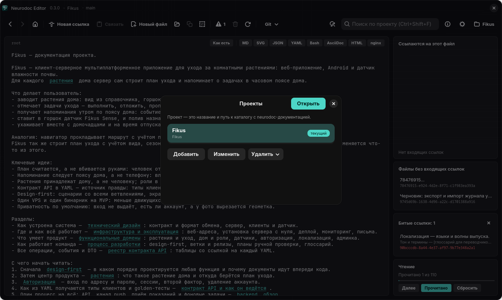
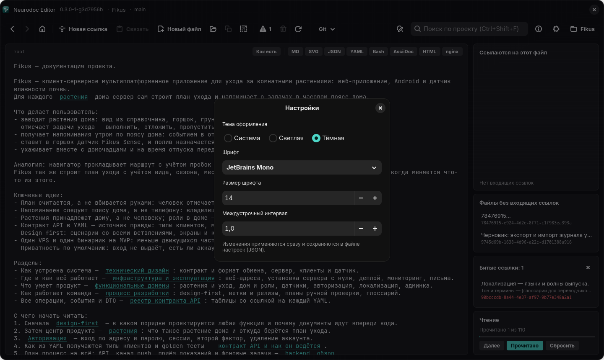

# Проекты и настройки

Проект в Neurodoc Editor — это название и путь к папке с каталогом neurodoc. Список
проектов и настройки вида (тема, шрифт, размер, интервал) хранит само приложение, а файлы
каталога остаются там, где лежали. В этой главе — диалоги «Проекты» и «Настройки» и то,
где приложение держит свои файлы на каждой платформе.

## Проекты

Диалог «Проекты» открывает кнопка «Проекты» справа на панели инструментов: на ней
написано имя текущего проекта. На Android это пункт меню ⋮ «Проекты». Пока текущего
проекта нет, вместо редактора виден экран «Проект не выбран» с кнопкой «Открыть список
проектов». Windows- и Linux-версия в этом случае к тому же сами открывают диалог при
запуске.



*Список проектов: у текущего проекта метка «текущий»*

В списке у каждого проекта видны название и путь, у текущего — метка «текущий» (на
Android — точка после названия). Что можно сделать:

| Действие | Windows и Linux | Android |
| --- | --- | --- |
| открыть проект | выбрать и нажать «Открыть» или дважды щёлкнуть | коснуться строки |
| добавить | «Добавить» | «Добавить» |
| изменить название или путь | «Изменить» | значок карандаша |
| убрать из списка | «Удалить» с подтверждением | значок корзины, без подтверждения |

В форме проекта два поля: «Название» и «Путь к каталогу». Папку можно выбрать кнопкой
«Обзор…», на Android — «Выбрать папку…». На Android проект с выбранной так папкой сразу
сохраняется и открывается, а пустое название берётся из имени папки.

При сохранении приложение проверяет папку:

- если её нет, создаёт её вместе с файлом `root`, папкой `_content` и `ReadMe.md` с
  описанием формата;
- если она есть, добавляет только недостающее: пустой `root`, папку `_content`,
  `ReadMe.md` (если в папке нет файла `readme.md` в любом регистре). Остальные файлы
  не трогаются.

На Windows и Linux относительный путь превращается в полный, а на Linux ещё и `~/` в
начале пути разворачивается в домашнюю папку.

> [!NOTE]
> То же самое приложение делает при каждом открытии проекта. Если папку проекта удалили
> или переименовали, при следующем открытии на старом месте появится новый пустой
> каталог.

«Удалить» убирает проект только из списка, файлы на диске не удаляются. На Windows и
Linux перед этим появляется вопрос «Удалить проект из списка? Файлы на диске не
удаляются.». Если удалить текущий проект, текущим станет первый оставшийся в списке.
Если текущего проекта нет, добавленный проект сам становится текущим.

При открытии проекта:

- открывается `root`;
- загружается прогресс чтения именно этого проекта (см. [Панели графа и порядок
  чтения](panels.md));
- если в каталоге остались ссылки старого вида `<uuid>`, приложение предлагает их
  перевести (см. [Переход со старого формата ссылок](migration.md));
- название проекта и текущая ветка git появляются в строке заголовка (на Android — в
  верхней панели).

Текущий проект открывается и при следующем запуске приложения.

Проект можно получить и с сервера: пункт «Клонировать с сервера…» в меню «Git» (на
Android — в окне «Git…») клонирует репозиторий, добавляет его в список и открывает (см.
[Совместная работа через git](git.md)).

Android-версии нужен доступ ко всем файлам устройства: каталоги лежат в общей памяти.
Если доступа нет, при запуске появится диалог «Нужен доступ к файлам» с кнопкой
«Открыть настройки».

## Настройки

Диалог «Настройки» открывает кнопка с шестерёнкой справа на панели инструментов, на
Android — пункт меню ⋮ «Настройки».



*Настройки Linux-версии: тема, шрифт, размер и междустрочный интервал*

| Настройка | Windows и Linux | Android |
| --- | --- | --- |
| «Тема оформления» | «Система», «Светлая», «Тёмная» | «Системная», «Светлая», «Тёмная» |
| «Шрифт» | любой шрифт системы, плюс встроенные Inter и JetBrains Mono | JetBrains Mono, Inter или «Системный» |
| «Размер шрифта» | от 8 до 96 | ползунок от 10 до 28 |
| «Междустрочный интервал» | от 0.8 до 3.0, шаг 0.1 | ползунок от 1.0 до 2.5 |

Кнопки «Сохранить» нет: изменения применяются сразу и тут же записываются в файл
настроек. Шрифт, размер и интервал действуют на редактор и на отрисованные документы в
просмотре MD и AsciiDoc. Подсвеченный код берёт из настроек шрифт и размер, на Android —
только размер (см. [Просмотр форматов](viewers.md)). Тема «Система» («Системная» на
Android) следует за оформлением операционной системы.

Значения по умолчанию:

| | Шрифт | Размер | Интервал |
| --- | --- | --- | --- |
| Windows | Consolas | 14 | 1.0 |
| Linux | JetBrains Mono | 14 | 1.0 |
| Android | JetBrains Mono | 15 | 1.2 |

В списке шрифтов на Windows и Linux есть ещё Anthropic Sans. Вместе с приложением этот
шрифт не поставляется и сработает, только если установлен в системе. На Android внизу
диалога показана версия приложения; на Windows и Linux она видна в заголовке окна.

### Встроенные шрифты

Inter и JetBrains Mono поставляются вместе с приложением (лицензия SIL OFL):

- **Windows** при первом запуске устанавливает их для текущего пользователя, права
  администратора не нужны. Если после самого первого запуска встроенный шрифт не
  применился к тексту, перезапустите приложение.
- **Linux** при запуске копирует их в `~/.local/share/fonts/neurodoc-editor/`.
- **Android** держит их в ресурсах приложения.

В отрисованные документы встроенный шрифт вкладывается прямо в страницу, поэтому он
работает и там.

## Что ещё хранится в настройках

Кроме параметров из диалога, в файле настроек лежат:

- список проектов и текущий проект;
- состояние режима «Как есть»: он общий для всех файлов и переживает перезапуск;
- фон просмотра рисунков SVG, отдельно для каждого проекта (см. [Просмотр
  форматов](viewers.md));
- на Android — имя и почта автора коммитов и токены доступа к git-серверам (см.
  [Совместная работа через git](git.md)).

Если файл настроек повреждён, приложение всё равно запустится — со значениями по
умолчанию. Недопустимые значения, например размер шрифта вне диапазона, приложение
заменяет допустимыми само.

## Где лежат файлы приложения

| Что | Windows | Linux | Android |
| --- | --- | --- | --- |
| настройки и проекты | `%APPDATA%\NeurodocEditor\settings.yaml` | `~/.config/neurodoc-editor/settings.json` | `settings.json` в приватной папке приложения |
| прогресс чтения | `%APPDATA%\NeurodocEditor\reading\` | `~/.config/neurodoc-editor/reading/` | `reading/` в приватной папке |
| резервные копии миграции | `%APPDATA%\NeurodocEditor\backups\` | `~/.local/share/neurodoc-editor/backups/` | `backups/` в приватной папке |
| журнал ошибок | `%APPDATA%\NeurodocEditor\error.log` | `~/.local/state/neurodoc-editor/error.log` | — |

Прогресс чтения хранится отдельным файлом на каждый проект: на Windows в YAML, на Linux
и Android в JSON. `settings.json` на Linux и Android устроен одинаково, только на Android
в нём есть ещё поля для git.

На Linux пути следуют XDG: если заданы `XDG_CONFIG_HOME`, `XDG_DATA_HOME` или
`XDG_STATE_HOME`, используются они. Так удобно запустить отдельный экземпляр с
собственными настройками и списком проектов, не трогая основные:

```bash
XDG_CONFIG_HOME=/tmp/nd/config neurodoc-editor
```

Здесь `neurodoc-editor` — команда, которую ставит `./linux-deploy.sh`; из исходников
то же самое делает `XDG_CONFIG_HOME=/tmp/nd/config ./linux-run.sh`.

На Android `settings.json` исключён из облачного резервного копирования: в нём лежат
git-токены. Удаление приложения удаляет и его приватную папку вместе с настройками.
