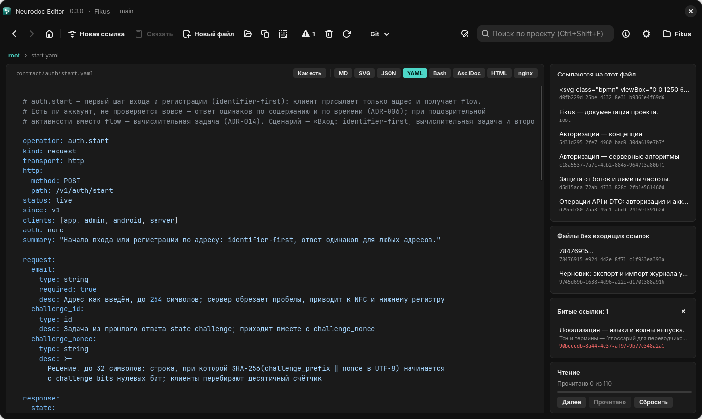
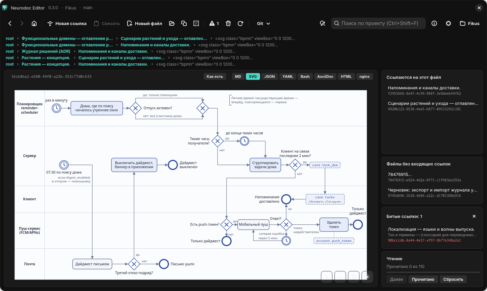
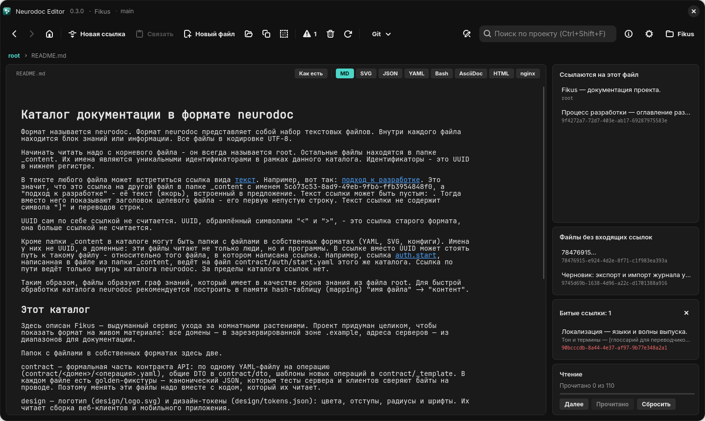

# Просмотр форматов

В каталоге neurodoc лежат не только заметки: рядом живут YAML-контракты, SVG-схемы,
конфиги, Markdown. Ряд кнопок над редактором показывает текущий файл в его настоящем
виде: рисунком, отрисованным документом или кодом с подсветкой. Просмотр служит для
чтения, а чтобы править, достаточно вернуться к тексту.

*Контракт `contract/auth/start.yaml` сразу показан с подсветкой YAML*

## Кнопки

На Windows и Linux кнопки стоят в шапке редактора, справа от id открытого файла. На
Android они занимают строку чипов под верхней панелью, после «Прочитано» и «Далее».
Порядок везде один — как в таблице:

| Кнопка | Как показывается файл |
| --- | --- |
| «Как есть» | текст ровно как на диске, без сворачивания ссылок |
| «MD» | Markdown, отрисованный как документ |
| «SVG» | рисунок с масштабированием |
| «JSON» | JSON с отступами и подсветкой |
| «YAML» | YAML с подсветкой |
| «Bash» | скрипт с подсветкой |
| «AsciiDoc» | AsciiDoc, отрисованный как документ |
| «HTML» | HTML-страница |
| «nginx» | конфигурация nginx с подсветкой |

«MD» стоит первым из форматов: он нужен чаще остальных.

Нажатие кнопки включает режим, повторное возвращает к тексту. Одновременно включён
только один режим. Перед переключением файл сохраняется, и просмотр строится из
того текста, что сейчас в редакторе.

## Режим по расширению

Файл в собственном формате открывается сразу в подходящем виде. Режим выбирается по
расширению, регистр не важен:

| Расширение | Режим |
| --- | --- |
| `.md`, `.markdown` | MD |
| `.svg` | SVG |
| `.json` | JSON |
| `.yaml`, `.yml` | YAML |
| `.sh`, `.bash` | Bash |
| `.adoc`, `.asciidoc` | AsciiDoc |
| `.html`, `.htm` | HTML |
| `.conf`, `.nginx` | nginx |

Остальные файлы открываются текстом.

В каталоге Fikus, например, `design/logo.svg` сразу показывается рисунком,
`design/tokens.json` — отформатированным JSON, а `README.md` — отрисованным документом.
Заодно такой файл труднее задеть случайно: чтобы его поправить, сначала нужно отжать
кнопку формата.

У `root` и файлов из `_content` расширения нет, поэтому они открываются текстом. Если в
`_content` лежит SVG-схема, скрипт или конфиг, нужный вид выберите кнопкой. Когда такой
файл класть в `_content`, а когда в отдельную папку, рассказано в главе [Файлы в
собственных форматах](../format/own-formats.md).

## Выбор запоминается

Расширение решает только при первом заходе в файл. Дальше режим запоминается вместе с
кареткой и прокруткой и при возврате в файл побеждает расширение:

- выключили отрисовку у `.md`, чтобы править текст, — при возврате файл снова откроется
  текстом;
- включили SVG у схемы из `_content` — при возврате она снова будет рисунком.

Эта память живёт до смены проекта или перезапуска приложения.

## «Как есть» — тоже режим

«Как есть» показывает файл ровно так, как он лежит на диске: ссылки не сворачиваются,
видна вся запись `[якорь](цель)`. Режим нужен, чтобы править текст посимвольно, —
подробнее в главе [Редактирование и ссылки](editing.md#режим-как-есть).

Это такой же режим показа, как SVG или MD, а не отдельный переключатель. Включение «Как
есть» выключает отрисованный формат, а выбор формата выключает «Как есть». Поэтому на
Windows и Linux «Как есть» выключится и тогда, когда вы откроете файл, который
показывается отрисованным сам, например `.yaml`. На Android в этом случае «Как есть»
остаётся включённым и снова действует, когда вы вернётесь к тексту.

В отличие от форматов, «Как есть» не привязан к файлу. Это настройка приложения: она
действует на все файлы и сохраняется между запусками.

## Рисунки SVG

*BPMN-схема из каталога Fikus, кнопки масштаба в правом нижнем углу*

Рисунок открывается вписанным в окно, но не крупнее натуральной величины. Дальше:

- колесо мыши меняет масштаб вокруг точки под курсором, щипок двумя пальцами — вокруг
  точки между пальцами;
- перетаскивание сдвигает рисунок;
- двойной щелчок по вписанному рисунку увеличивает его в 2,5 раза в этой точке, а если
  масштаб уже меняли, вписывает рисунок обратно;
- при изменении размера окна рисунок вписывается заново.

| Кнопка в углу | Подсказка | Действие |
| --- | --- | --- |
| + | «Крупнее» | увеличить |
| − | «Мельче» | уменьшить |
| ↺ | «Вписать в окно» | вернуть исходный масштаб |
| ☀ / ☽ | «Светлый фон» / «Тёмный фон» | переключить фон |

У BPMN-схем часто нет собственных размеров, только `viewBox`. Такие рисунки тоже
показываются: размеры берутся из `viewBox`.

### Фон рисунков — настройка проекта

Пока вы не трогали кнопку ☀/☽, фон рисунков следует теме приложения. Первое же
переключение запоминается за проектом и дальше побеждает тему: рисунки одного проекта
обычно нарисованы под один фон. Фон меняется сразу, без перезагрузки рисунка.

Выбор хранится в настройках приложения, в записи проекта (см. [Проекты и
настройки](settings.md)). В сам каталог и в git он не попадает.

## Markdown и AsciiDoc

*Описание формата `README.md` в режиме MD*

Документ верстается шрифтом из настроек редактора: семейство, размер и междустрочный
интервал те же, что у текста. Код остаётся моноширинным при любом шрифте, а блоки кода в
Markdown подсвечиваются.

Ссылки в отрисованном документе работают:

- ссылка neurodoc разбирается относительно текущего файла и открывается в том же окне,
  как по щелчку в редакторе;
- адреса `http(s)://…` открываются в браузере;
- ссылка на несуществующий файл никуда не ведёт. Например, в `README.md` ссылки из
  описания формата указывают на файлы-примеры, которых в каталоге нет.

Markdown сам превращает `[текст](цель)` в ссылку. AsciiDoc такого синтаксиса не знает,
поэтому приложение размечает такие места само. Внутри блоков кода ссылки остаются кодом.

## JSON, YAML, Bash и nginx

Эти режимы показывают код с подсветкой синтаксиса. Шрифт и размер берутся из настроек
редактора; на Android — только размер, а шрифт кода там всегда моноширинный. JSON
дополнительно форматируется с отступами: кириллица остаётся кириллицей, порядок ключей не
меняется. На Windows и Linux разбору не мешают висячие запятые и комментарии, но в
просмотре комментариев не будет. Если JSON разобрать не удалось, он показывается как есть.

> [!NOTE]
> В подсвеченном коде ссылки не кликабельны. Если конфиг из `_content` ссылается на
> другие файлы, вернитесь к тексту: там ссылки работают как обычно.

## HTML

Полный документ с тегом `<html>` показывается как есть. Фрагмент без него выводится на
белом фоне: авторская разметка без стилей на тёмной теме была бы нечитаемой.

## Без сети

Для просмотра сеть не нужна. Библиотеки highlight.js (вместе с грамматикой nginx),
marked и Asciidoctor.js поставляются с приложением и встраиваются прямо в страницу, а в
отрисованные документы вкладывается и встроенный шрифт, если он выбран в настройках.
Страницу рисует браузерный движок платформы: WebView2 на Windows, WebKitGTK на Linux и
WebView на Android.

Смена темы или шрифта в настройках сразу перерисовывает открытый просмотр. На Windows и
Linux поиск по файлу (<kbd>Ctrl</kbd>+<kbd>F</kbd>) и «Поиск и замена» возвращают
файл к тексту: искать и заменять можно только в тексте.
