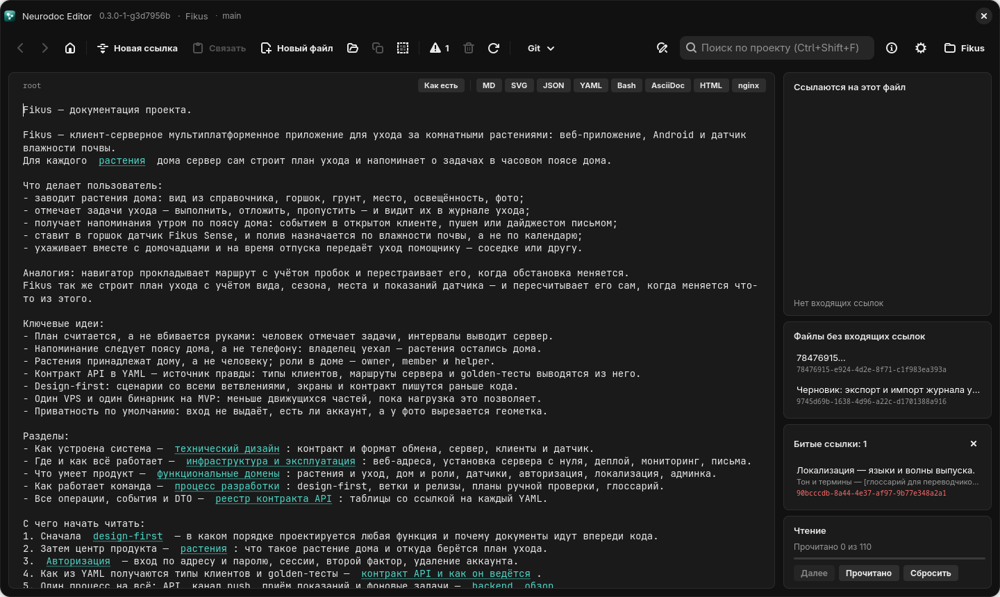
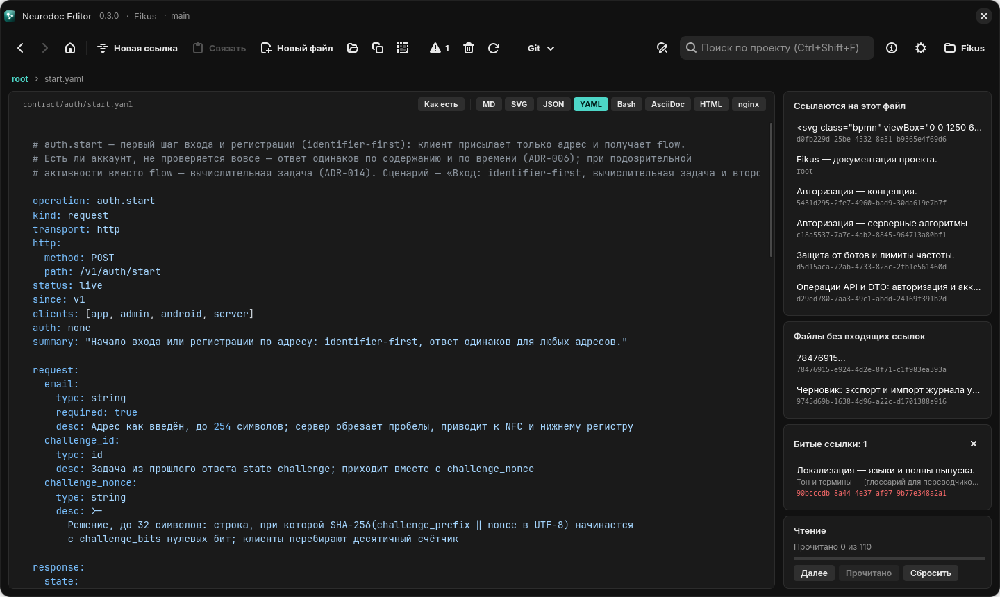
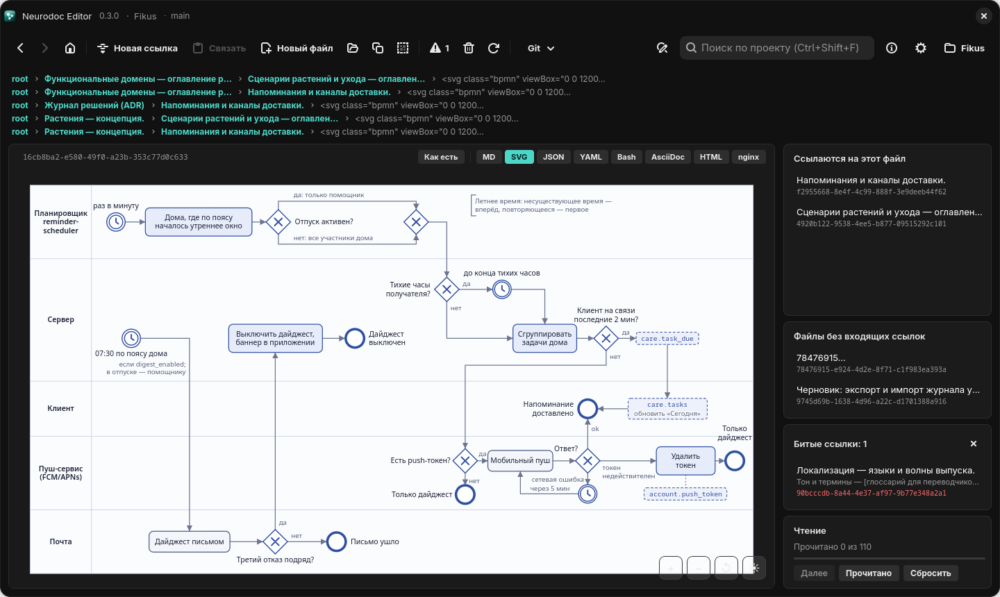
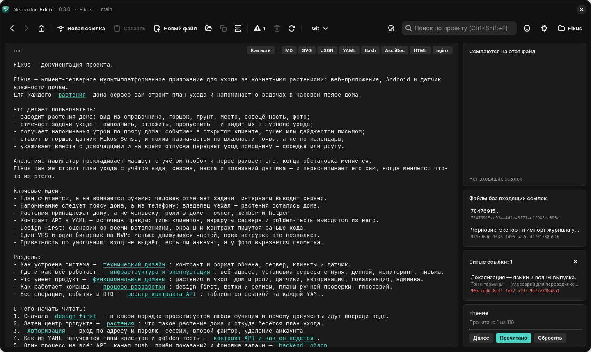

# Каталог Fikus

В папке `example/` репозитория лежит готовый каталог neurodoc — документация выдуманного
сервиса Fikus для ухода за комнатными растениями. На нём удобно знакомиться с форматом и
редактором. На нём же идут проверки: тесты Linux-версии, её самопроверка и снимки экрана для
этой книги.

Проект придуман целиком. Домены лежат в зарезервированной зоне `.example`, адреса серверов
взяты из диапазонов для документации (`203.0.113.0/24` и `2001:db8::/32`). Люди в примерах —
Анна, Борис и Вера, их почта — на `example.com`.



*`root` каталога Fikus. Справа — два файла без входящих ссылок, одна битая ссылка и прогресс чтения*

## Как открыть

Редактор сохраняет правки сразу, поэтому открывайте не сам `example/`, а его копию:

```bash
cp -r example ~/fikus
```

Затем добавьте `~/fikus` как проект в диалоге «Проекты» — см. [Первые шаги](editor/first-steps.md).

## Что внутри

```text
example/
├── root                  описание продукта, оглавление, маршрут чтения, статус и TODO
├── README.md             описание формата neurodoc и этого каталога
├── _content/             больше сотни файлов с именами-UUID
├── contract/             контракт API: больше восьмидесяти YAML-файлов
│   ├── auth/start.yaml   по файлу на операцию: contract/<домен>/<операция>.yaml
│   ├── dto/Plant.yaml    общие DTO
│   └── _template/        шаблоны новой операции и push-события
└── design/
    ├── logo.svg          логотип
    └── tokens.json       дизайн-токены: цвета, отступы, радиусы, шрифты
```

Связей в каталоге около тысячи: примерно 600 ссылок по UUID и 400 ссылок-путей на
файлы в собственных форматах.

## С чего начать

`root` описывает продукт и его ключевые идеи, а ниже даёт оглавление из пяти разделов:

- **технический дизайн** — контракт и формат обмена, сервер, хранение данных, фоновые
  задачи, клиенты и датчик;
- **инфраструктура и эксплуатация** — веб-адреса, установка сервера с нуля, деплой,
  мониторинг, режим обслуживания, письма;
- **функциональные домены** — растения и план ухода, напоминания, дом и роли, датчики,
  авторизация, локализация, админка;
- **процесс разработки** — design-first, журнал решений, планы ручной проверки, глоссарий;
- **реестр контракта API** — таблицы операций, DTO и push-событий со ссылкой на каждый YAML.

Под оглавлением — маршрут «С чего начать читать» из шести ссылок: design-first, растения,
авторизация, контракт API, обзор сервера и журнал решений. Это совет автора каталога, а
не маршрут кнопки «Далее»: та обходит все файлы подряд, в глубину, в порядке ссылок
(см. [Порядок чтения](editor/panels.md#порядок-чтения)).

## Файлы в собственных форматах

`contract/` — формальная часть контракта API, по YAML-файлу на операцию. В каждом файле
есть golden-фикстуры — канонический JSON ([RFC 8785](https://www.rfc-editor.org/rfc/rfc8785)),
по которым тесты сервера и клиентов сверяют байты на проводе. Таблицы реестра в `_content/`
ссылаются на каждый такой файл по пути. Путь считается от того файла, где написана ссылка,
поэтому один и тот же файл из разных мест адресуется по-разному:

```text
[auth.start](contract/auth/start.yaml)        — из root
[auth.start](../contract/auth/start.yaml)     — из файла в _content/
```

YAML-файл открывается сразу отрисованным: режим выбирается по расширению (см.
[Просмотр форматов](editor/viewers.md#режим-по-расширению)).



`design/` — логотип и дизайн-токены. Их читает сборка клиентов, а на них самих ссылается
страница дизайн-системы. Зачем такие файлы держат вне `_content/` — в главе
[Файлы в собственных форматах](format/own-formats.md).

## Что лежит в `_content/`

Простой текст и Markdown — лишь часть каталога. Пример показывает, что в `_content/` может
лежать файл любого текстового формата:

| Формат | Что в каталоге |
|---|---|
| простой текст | концепции: растения, дом и роли, авторизация, датчики, локализация |
| Markdown | реестры операций, DTO и push-событий; экраны; планы ручной проверки; журнал решений |
| SVG | 18 BPMN-схем сценариев: вход, сброс пароля, пересчёт плана ухода, обновление прошивки… |
| конфиги | сайт nginx, общие параметры TLS, unit systemd |
| bash | скрипт резервного копирования базы |
| HTML | страница режима обслуживания |
| JSON | полный ответ `plants.get` — карточка растения |
| AsciiDoc | сборка и прошивка датчика |

У таких файлов нет расширения, поэтому вид выбирают кнопкой над редактором, и выбор
запоминается.



Ссылки в них спрятаны так, чтобы файл оставался правильным для своей программы. В конфигах
и скрипте они стоят в строках-комментариях `# …`, в HTML и SVG — внутри `<!-- … -->`, а в
JSON — в строках массива `"$links"`. nginx и bash видят комментарий, редактор — ссылку.

## Что на нём проверяют

Пример нарочно содержит всё, что редактор обязан показать правильно:

- **Одна битая ссылка.** Файл «Локализация» ссылается на глоссарий для переводчиков, а того
  ещё нет. Ссылку видно в карточке «Битые ссылки».
- **Два файла без входящих ссылок**: пустой файл и черновик «Экспорт и импорт журнала
  ухода», на которые не ведёт ни одна ссылка.
- **Пустые якоря** `[](uuid)` в списках «См. также»: вместо текста редактор показывает
  заголовок цели.
- **Несколько кратчайших путей.** Больше чем у половины файлов их несколько, и панель путей
  показывает все.
- **Глубокая цепочка.** Общие параметры TLS для nginx лежат в пяти шагах от `root`:
  технический дизайн → отказы и исходы операций → схема маршрутизации запросов → конфиг
  nginx → параметры TLS.
- **Веб-адреса.** Голые адреса стоят в тексте, таблицах и коде, в том числе вплотную к
  точке, запятой и скобке. Есть и ссылки вида `[RFC 8785](https://…)`.
- **Ссылки-пути из разных мест**: из `root` в подпапки (`contract/…`, `design/…`) и из
  `_content/` на уровень выше (`../contract/…`, `../README.md`).



## Если меняете пример

Тесты Linux-версии опираются на конкретные файлы и слова примера: `contract/auth/start.yaml`,
`contract/dto/Account.yaml`, ссылку из концепции растений на `contract/dto/Plant.yaml`,
поиск по слову «fikus». Самопроверке нужны `root` и `README.md` длиннее окна и SVG-схема в
`_content/`. Поэтому после правки `example/` прогоните `cargo test` и самопроверку — см.
[Проверки](dev/testing.md).

Репозиторий публичный, так что в пример попадает только выдуманное: домены в зоне
`.example`, адреса из диапазонов для документации, вымышленные люди.
