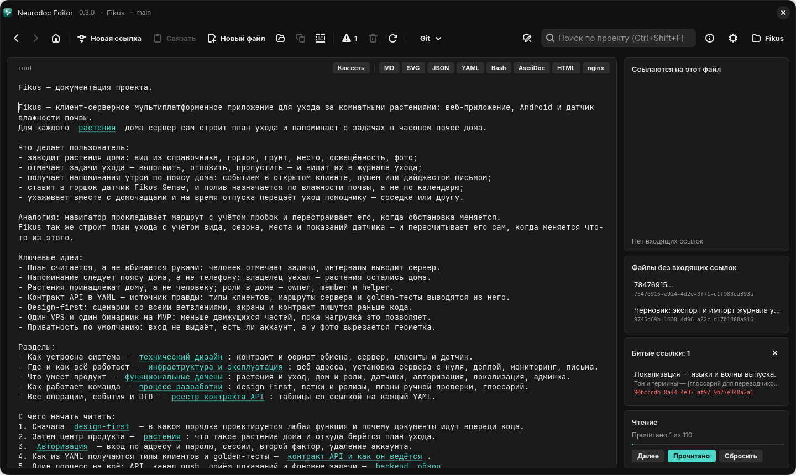

# Граф знаний

Файлы каталога — вершины, ссылки — рёбра, корень — `root`. Всё, что Neurodoc Editor
показывает о связях, выводится из этого графа: обратные ссылки, сироты, битые ссылки,
пути от `root` и порядок чтения.

Рёбра выходят только из `root` и заметок `_content`: файлы в собственных форматах бывают
лишь концами рёбер. Ссылка файла на самого себя ни обратной, ни входящей не считается.

## Обратные ссылки

Файлы, которые ссылаются на данный. Их считают по разобранным целям, а не поиском
подстроки: один и тот же файл из разных папок адресуется разными путями (см.
[Ссылки](links.md)).

В редакторе это карточка «Ссылаются на этот файл» — см.
[Панели графа и порядок чтения](../editor/panels.md#ссылаются-на-этот-файл).

## Сироты

Заметки, кроме `root`, на которые не ссылается ни один другой файл. В здоровом каталоге
их нет: по ссылкам до такой заметки читатель не дойдёт. В редакторе это карточка
[«Файлы без входящих ссылок»](../editor/panels.md#файлы-без-входящих-ссылок).

Сирота — это именно «нет входящих ссылок», а не «недостижим от `root`». Заметка, на которую
ссылается только другая сирота, сиротой не считается, хотя от `root` до неё не добраться:
выдаёт её только отсутствие путей от `root`. Файлы в собственных форматах сиротами не
бывают вовсе: их могут читать программы (см. [Файлы в собственных форматах](own-formats.md)).

## Битые ссылки

Ссылки, цель которых не существует, и ссылки отвергнутые — ведущие выше корня, с
абсолютным путём или с двоеточием в цели (буква диска, `mailto:`). Веб-адреса
`http(s)://` не проверяются. Каждое вхождение — отдельная запись: в каком файле, строка
вокруг ссылки и цель — уже разобранная относительно файла (для `[…](root)` в заметке это
`_content/root`), а отвергнутая — как написана.



*Карточка «Битые ссылки»: файл, строка со ссылкой и цель*

Как редактор показывает битые ссылки и как к ним перейти, рассказано в главе
[Панели графа и порядок чтения](../editor/panels.md#битые-ссылки).

Битую ссылку можно оставить и намеренно — на документ, который ещё не написан. Переход по
ней открывает пустой файл; стоит начать писать — автосохранение его создаст, вместе с
недостающими папками.

## Пути от root

Кратчайшие пути от `root` до файла показывают, как читатель может прийти к нему от
главной страницы; редактор выводит их «хлебными крошками» над текстом (см.
[Панели графа и порядок чтения](../editor/panels.md#пути-от-root)). Пути идут только через
заметки; файл в собственном формате может быть последним звеном. У `root` и у файлов, до
которых от `root` не дойти, путей нет.

Считаются пути в два шага: обход в ширину от `root` находит расстояния, затем
перечисляются только пути ровно минимальной длины. Обход в глубину с ограничением числа
путей здесь не годится: он набирает лимит длинными путями и до короткого может не дойти.

## Порядок чтения

Порядок, в котором стоит прочитать весь каталог, — обход в глубину от `root` по порядку
ссылок в тексте: порядок ссылок — замысел автора.

```text
порядок = [], пройдено = {}, стек = [root]
пока стек не пуст:
    файл = снять верхний со стека
    если файл уже пройден: перейти к следующему
    добавить файл в пройдено и в порядок
    дети = цели ссылок файла по порядку в тексте: только существующие заметки
           (root и _content), ещё не пройденные, без повторов
    положить детей в стек в обратном порядке — первым прочтётся первый по тексту
в конец порядка — остальные заметки, до которых от root не дойти, по порядку имён
```

Каждая заметка встречается ровно один раз, циклы отсекаются множеством пройденных.
Файлы в собственных форматах в обход не входят: это справочные данные. Хвост из
недостижимых заметок нужен, чтобы «прочитать всё» было вообще возможно.

По этому порядку ведёт кнопка «Далее»: она открывает первую непрочитанную заметку.
Отметки «Прочитано» — состояние читателя, а не документации: они хранятся на устройстве,
а не в каталоге. Как редактор ставит отметки и считает прогресс — в главе
[Панели графа и порядок чтения](../editor/panels.md#прогресс-чтения).
