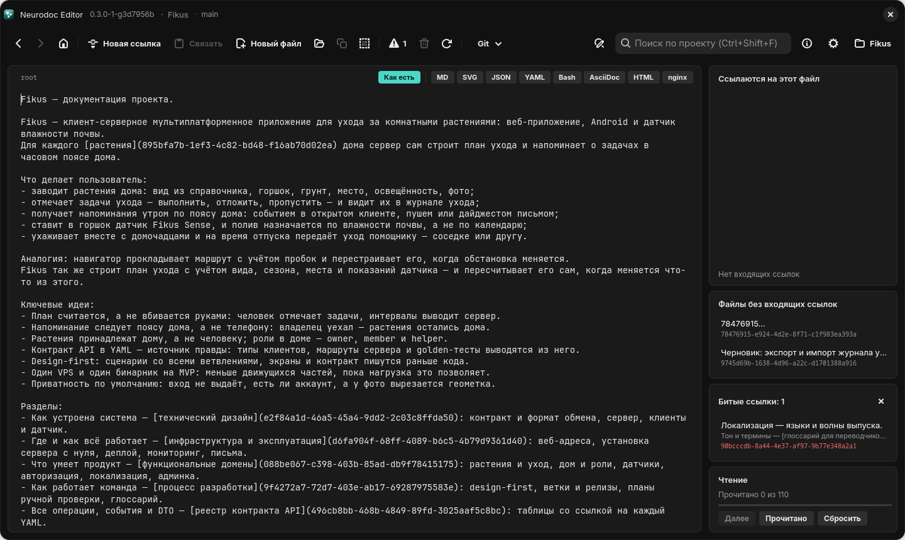

# Ссылки

Ссылка — единственная разметка формата neurodoc. Она встраивается в предложение и
связывает файлы каталога в граф. Здесь — синтаксис, правила, по которым цель превращается
в файл, и то, что ссылкой не считается.

## Синтаксис

```text
Прежде чем писать код, прочитайте про [подход к разработке](5c673c53-8ad9-49eb-9fb6-ffb3954848f0).
```

- **Якорь** — текст в квадратных скобках, часть предложения. Он однострочный и не
  содержит `]`.
- **Цель** — в круглых скобках: UUID заметки из `_content` или путь к файлу каталога. В
  цели не бывает пробелов, круглых скобок и обратной косой черты.
- `]` и `(` стоят вплотную, без пробела.

Точное определение — регулярное выражение, общее для всех трёх версий редактора: группа 1 —
якорь, группа 2 — цель.

```text
\[([^\]\n]*)\]\(([^()\s\\]+)\)
```

## Пустой якорь

`[](5c673c53-8ad9-49eb-9fb6-ffb3954848f0)` — вместо текста показывают заголовок целевого
файла, его первую непустую строку. Такая ссылка не устаревает: поправили заголовок цели —
показывается уже новый.

Neurodoc Editor заголовок в текст не подставляет: такая ссылка выглядит кружком (на
Android — значком ●), а заголовок цели на Windows и Linux всплывает в подсказке при
наведении мыши.

## Куда ведёт цель

**UUID** ведёт на заметку `_content/<uuid>` — откуда бы ни была написана ссылка. Регистр
букв в UUID не важен: цель приводится к нижнему регистру.

**Путь** считается от папки того файла, где написана ссылка. У `root` это корень каталога,
у заметок — папка `_content`. Сегмент `.` пропускается, `..` поднимает на уровень вверх.
Поэтому один и тот же файл из разных мест записывается по-разному:

| Ссылка написана в | Цель | Ведёт на |
| --- | --- | --- |
| `root` | `contract/auth/start.yaml` | `contract/auth/start.yaml` |
| заметке из `_content` | `../contract/auth/start.yaml` | `contract/auth/start.yaml` |
| заметке из `_content` | `contract/auth/start.yaml` | `_content/contract/auth/start.yaml` — такого нет, ссылка битая |
| заметке из `_content` | `../root` | `root` |
| заметке из `_content` | `root` | `_content/root` — битая |
| `root` | `_content/5c673c53-…` | `5c673c53-…` — то же, что просто UUID |

Главное следствие: **цель неполна без источника**. Обратные ссылки поэтому не ищут
подстрокой — только по разобранным целям (см. [Граф знаний](graph.md)).

Фрагментов `#раздел` формат не знает: в `README.md#раздел` решётка — часть имени файла,
и такая ссылка битая.

## Только внутрь каталога

Ссылка на файл не выводит за пределы каталога. Отвергаются цели:

- поднимающиеся выше корня: `../outside.yaml`, написанная в `root`;
- абсолютные: `/etc/hosts`;
- с двоеточием, в том числе с буквой диска: `C:/x.yaml`.

Отвергнутая ссылка не подсвечивается в редакторе и попадает в
[битые ссылки](graph.md#битые-ссылки). Вместе с
синтаксисом эти правила ограничивают имена файлов, на которые ссылаются по пути: без
пробелов, круглых скобок, обратной косой черты и двоеточия, без `..` внутри имени — иначе
ссылка не разберётся или окажется битой.

## Веб-адреса

`[сайт](https://example.com)` — внешняя ссылка: в граф каталога она не входит и битой не
считается. Редактор показывает её целиком и по щелчку открывает в браузере. Адрес
`http(s)://…`, написанный прямо в тексте, тоже подсвечивается и открывается по щелчку;
завершающая пунктуация предложения в адрес не входит. Других схем формат не знает:
у `[почта](mailto:…)` в цели двоеточие, и такая ссылка попадает в «Битые ссылки».

## Что ссылкой не считается

- Голый UUID: `5c673c53-8ad9-49eb-9fb6-ffb3954848f0`.
- UUID в угловых скобках `<5c673c53-…>` — ссылка прежнего формата; такой каталог
  редактор при открытии предлагает перевести, сделав резервную копию:
  [Переход со старого формата ссылок](../editor/migration.md).
- Запись с пробелом между `]` и `(`, с пробелом или скобкой в цели, с переводом строки
  или `]` в якоре.
- `[…](…)` внутри файлов в собственных форматах: в YAML или Markdown такая запись
  встречается сама по себе, поэтому ссылки читаются только из `root` и заметок `_content`.

Экранирования в формате нет: пример ссылки держат в файле собственного формата (так
устроен `ReadMe.md`) или разрывают синтаксис пробелом между `]` и `(`.

## Ссылки в редакторе



*Режим «Как есть»: ссылки видны целиком, вместе с целью*

- От ссылки на файл обычно виден только подчёркнутый якорь, служебная часть скрыта.
  Ссылки на уже прочитанные файлы гаснут, как посещённые в браузере.
- Режим «Как есть» показывает файл ровно как на диске — чтобы поправить ссылку
  посимвольно.
- «Новая ссылка» превращает выделенный текст или слово под кареткой в ссылку на новый
  файл (якорь становится его первой строкой) и переходит в него. «Копировать ссылку»
  кладёт в буфер обмена `[заголовок](цель)`, а «Связать» делает выделенный текст ссылкой
  на скопированный файл.

Подробнее, в том числе как связать текст с файлом в собственном формате, — в главе
[Редактирование и ссылки](../editor/editing.md).
