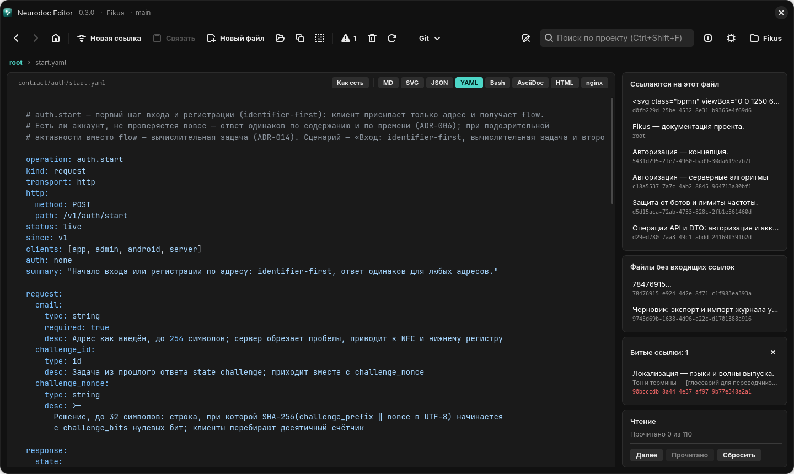

# Файлы в собственных форматах

Кроме заметок в `_content`, в каталоге лежат файлы, которые читают не только люди, но и
программы: контракты API в YAML, схемы в SVG, токены дизайна в JSON, конфиги, скрипты. У
них доменные имена и привычные расширения, а в граф знаний они входят как цели ссылок.

## Где лежат и как называются

Такие файлы лежат в любых папках каталога, кроме `_content` и папок с точкой в начале
имени, а также прямо в корне, рядом с `root`. В примере Fikus это, например:

```text
README.md
contract/auth/start.yaml       ← операция API
contract/dto/Account.yaml      ← DTO
contract/_template/            ← шаблоны контрактов
design/logo.svg
design/tokens.json
```

Идентификатор такого файла — путь от корня каталога через `/`; регистр букв в нём — часть
имени. Чтобы на файл можно было сослаться, имя должно укладываться в синтаксис ссылки: без
пробелов, круглых скобок, обратной косой черты и двоеточия, без `..` внутри имени.

## Как на них ссылаться

По пути относительно того файла, где написана ссылка:

| Ссылка написана в | Как записать |
| --- | --- |
| `root` | `[auth.start](contract/auth/start.yaml)` |
| заметке из `_content` | `[auth.start](../contract/auth/start.yaml)` |

Кнопка «Копировать ссылку» на таком файле кладёт в буфер вариант для заметки из `_content`
с именем файла вместо якоря — `[start.yaml](../contract/auth/start.yaml)`. «Связать» на
Windows и Linux сама пересчитывает этот путь от текущего файла; на Android она такую
ссылку из буфера пока не принимает. Правила разбора путей — в главе [Ссылки](links.md), а
как связать текст с таким файлом — в главе
[Редактирование и ссылки](../editor/editing.md#ссылки-на-файлы-в-собственных-форматах).

## Цели, но не источники

Файлы в собственных форматах участвуют в графе иначе, чем заметки:

- **Ссылки внутри них в граф не входят.** Обратных ссылок они не дают и в «Битые ссылки»
  не попадают: в YAML или Markdown последовательность `[текст](что-то)` встречается сама по
  себе. «Связать» в таком файле не срабатывает: на Windows и Linux кнопка неактивна, а
  <kbd>Ctrl</kbd>+<kbd>L</kbd> отвечает подсказкой «Здесь ссылок не бывает»; на Android
  пункт меню отвечает сообщением «Ссылки ставят только в файлах neurodoc».
- **Сиротами не бывают.** Файл без входящих ссылок живёт своей жизнью — его могут читать
  программы, — и в «Файлы без входящих ссылок» он не попадает.
- **В порядок чтения не входят.** Это справочные данные, их открывают по необходимости, а
  не подряд. Кнопка «Прочитано» для них недоступна, а «Далее» они не задерживают.
- **Заголовок — имя файла** (`start.yaml`), а не первая строка: у YAML или конфига она
  служебная.

SVG-схему или конфиг можно положить и в `_content` — тогда это обычная заметка с
именем-UUID: ссылки в ней, например в комментариях, входят в граф, а сама она участвует в
порядке чтения. Расширения у заметки нет, поэтому открывается она текстом, а отрисовать её
можно кнопкой формата. В папку с доменным именем файл кладут, когда его по пути читают
программы: контракт API, токены дизайна, рабочий конфиг.

## Как редактор их показывает

Файл в собственном формате со знакомым расширением редактор открывает сразу в просмотре:
Markdown и AsciiDoc — отрисованным документом, SVG — рисунком с масштабированием, YAML,
JSON, Bash и конфиги nginx — с подсветкой синтаксиса, HTML — страницей. Остальные файлы
открываются текстом. Чтобы править отрисованный файл, просмотр надо выключить осознанно —
так контракты труднее задеть случайно. Какое расширение какой режим включает и как
редактор запоминает выбор, рассказано в главе
[Просмотр форматов](../editor/viewers.md#режим-по-расширению).



*Файл в собственном формате: контракт `contract/auth/start.yaml` открыт сразу с подсветкой YAML*

В отрисованных MD и AsciiDoc ссылки кликабельны, цель разбирается относительно самого
отрисованного файла. Но в граф ссылки из файлов в собственных форматах всё равно не
входят.

## Что в каталог не попадает

Файлы и папки с точкой в начале имени, файлы больше 4 МБ и двоичные файлы при чтении
каталога пропускаются — подробности в главе [Каталог](catalog.md#что-при-чтении-пропускается).
Ссылка на существующий такой файл битой не считается, но показывать двоичные файлы
редактор не умеет, поэтому ссылаться на картинки в PNG или JPEG не стоит — схемы удобнее
держать в SVG.
